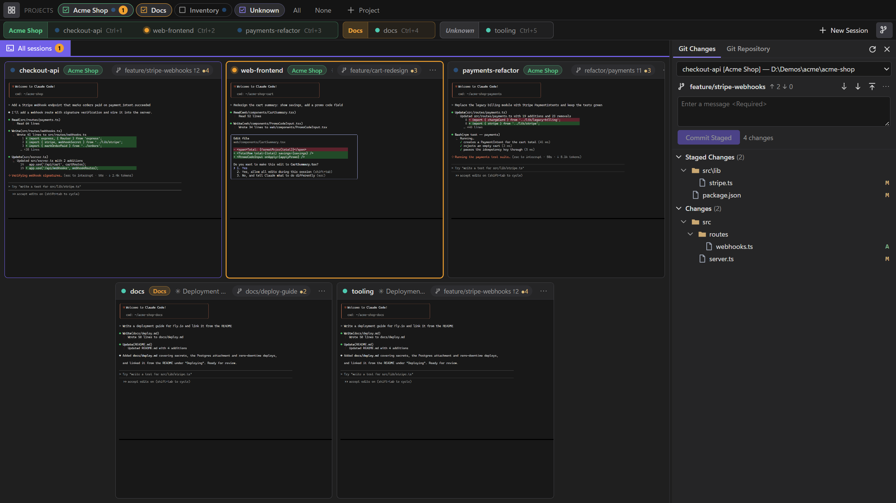
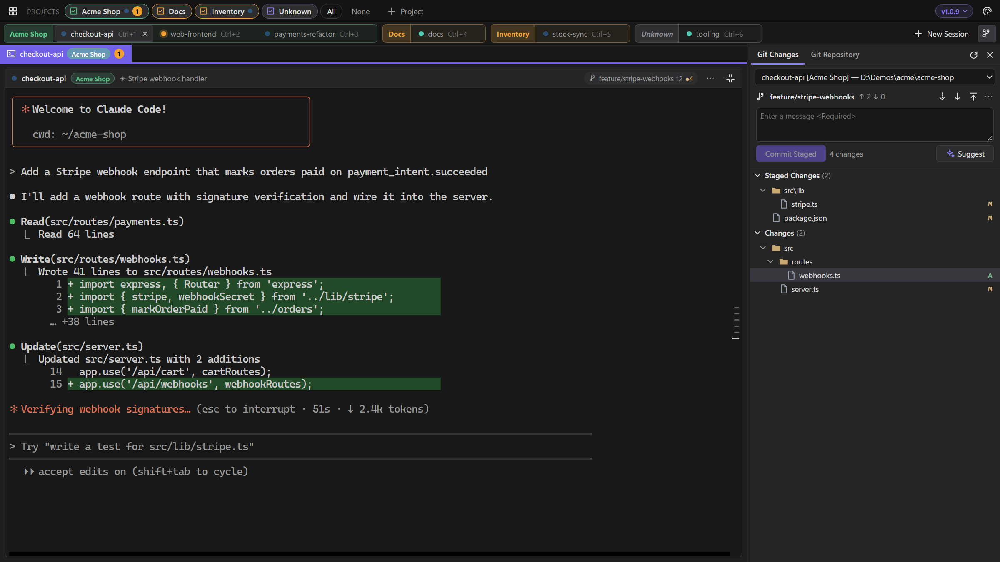
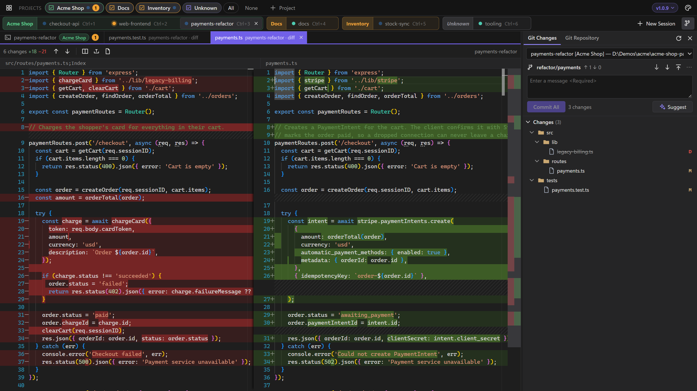
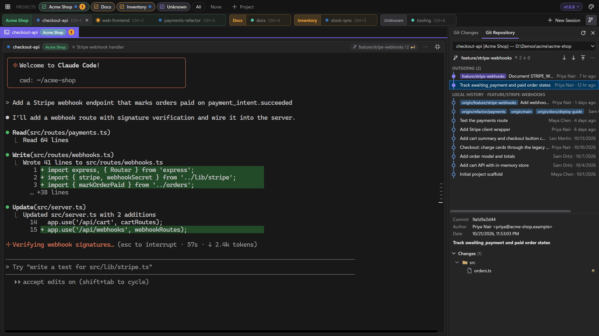
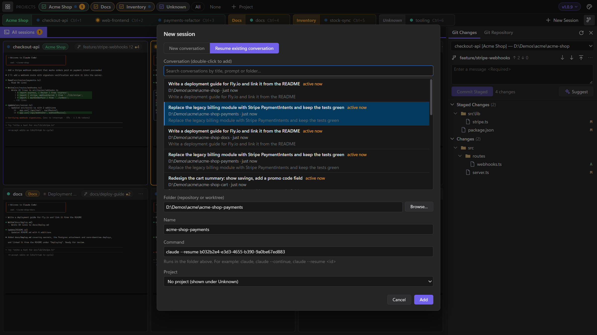
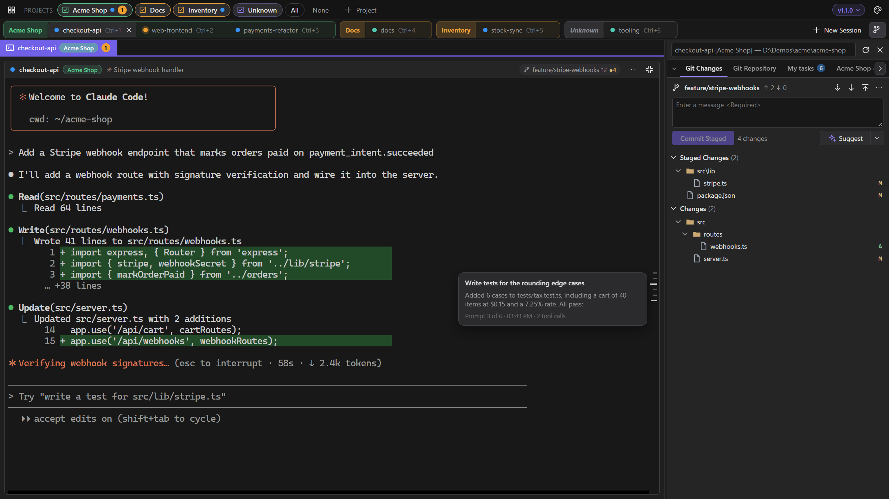
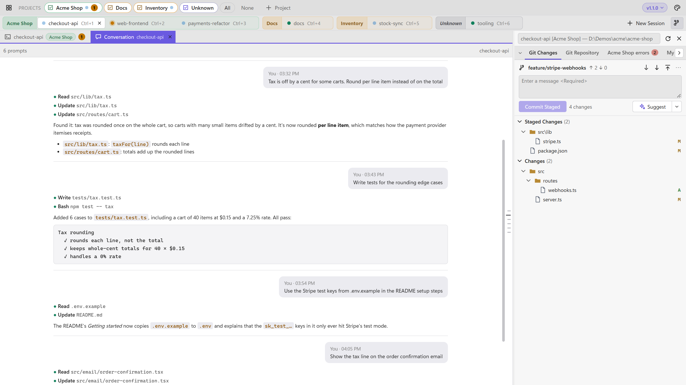
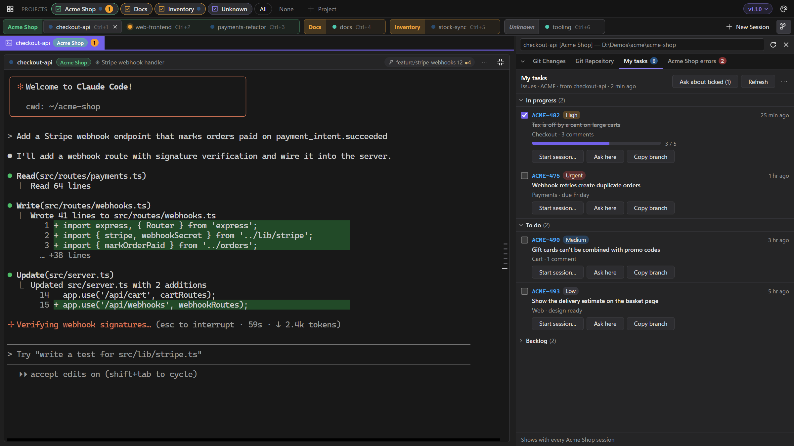
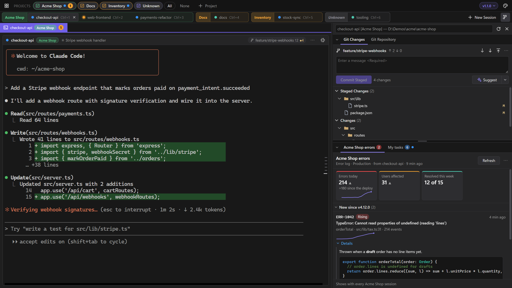

# Claude Terminals

One window for many local Claude Code sessions, with a Visual Studio–style Git Changes / Git Repository view and diff viewer for each session's worktree.



<sub>Tick projects on and off in the Projects row; each session tab group and tile is tagged with its project.</sub>

<table>
  <tr>
    <td width="50%"><a href="docs/images/session.png"></a><br><sub>Click a tile to work in that session full-size; <code>Shift+Esc</code> goes back. Fetch, pull and push from the Git toolbar.</sub></td>
    <td width="50%"><a href="docs/images/diff.png"></a><br><sub>VS-style side-by-side diffs open in tabs next to the terminal.</sub></td>
  </tr>
  <tr>
    <td width="50%"><a href="docs/images/history.png"></a><br><sub>Outgoing commits, history and each commit's changes.</sub></td>
    <td width="50%"><a href="docs/images/resume.png"></a><br><sub>Start fresh or resume any saved Claude Code conversation.</sub></td>
  </tr>
  <tr>
    <td width="50%"><a href="docs/images/rail.png"></a><br><sub>The ticks beside the terminal are your prompts: hover for a preview, click to read that part of the conversation.</sub></td>
    <td width="50%"><a href="docs/images/conversation.png"></a><br><sub>The whole conversation as text, here in the light theme (System, Light or Dark from the palette button).</sub></td>
  </tr>
  <tr>
    <td width="50%"><a href="docs/images/panels.png"></a><br><sub>Panels Claude shows beside the terminal: your tasks grouped by status, with ticks, badges and buttons that fill in a prompt for you.</sub></td>
    <td width="50%"><a href="docs/images/docking.png"></a><br><sub>Dock tabs where you want them: here Git Changes on top and an errors panel below, with stats, a trend and details.</sub></td>
  </tr>
</table>

<sub>Screenshots show a fictional demo project with simulated sessions; regenerate them with <code>tools\screenshots\run.ps1</code>.</sub>

## What it does

- **All your sessions in one window.** Every Claude Code session runs in its own real terminal, shown side by side as live tiles. Click one to work in it full-size; status dots show which are working, which are waiting for you and which need an answer before Claude can carry on.
- **Projects.** Group sessions (for example one product's worktrees) and show or hide each group; hidden sessions keep running and still tell you when they need you.
- **Git, Visual Studio style.** Each session's worktree gets Git Changes (stage, commit, Undo Changes, fetch, pull, push) and Git Repository (history, outgoing commits), with side-by-side diffs that update as Claude edits. **Suggest** writes the commit message for you, and a chip links the branch's pull request on GitHub or Azure DevOps.
- **Look back through a conversation.** A rail of ticks beside the terminal, one per prompt; hover for a preview, click to read the whole conversation in its own tab. Works even in Claude's full-screen mode.
- **Panels from Claude.** Claude can show your task list, an error summary or notes as a tab beside the Git panel, through a small MCP server built into the app; buttons on them only ever fill in a prompt for you. A ready-made example skill gets you started.
- **Arrange the side panel.** Drag tabs into groups stacked one above the other (Git Changes on top, your panels below, say), resize them, and fold any group down to its tabs.
- **Picks up where you left off.** Each session has a conversation of its own and reopens it when the app restarts, following you through `/clear`; you can also resume any saved conversation.
- **Light or dark, in your colours.** Follows Windows' light/dark mode and accent colour, or choose your own; Claude itself is started in matching colours.
- **Keeps itself up to date.** Tells you when a new version is out and installs it in a click; your sessions carry on afterwards.

## Install

Download `ClaudeTerminals-Setup-<version>.exe` from the [latest release](https://github.com/davellamachant/ClaudeTerminals/releases/latest) and run it. It installs for your account only (no admin), and later versions install themselves from inside the app.

Releases are signed by **Llamachant Technology Ltd**. If SmartScreen still warns about a new release ("Windows protected your PC"), check that the publisher says Llamachant Technology Ltd, then choose *More info › Run anyway*.

### Requirements

- Windows 10 1809+ or Windows 11 (x64)
- [Claude Code](https://docs.anthropic.com/en/docs/claude-code) on `PATH`, plus Git
- WebView2 Runtime (built into Windows 11; setup offers the download if it's missing)
- To build it yourself: .NET 10 SDK and Node.js (for the bundled xterm.js / Monaco packages)

## Using it

| Action | How |
|---|---|
| Expand a session | Click its tile, its tab in the title bar, or press `Ctrl+1`…`Ctrl+9` |
| Back to all sessions | Click the open session's tab again, `Shift+Esc`, the collapse button in the tile header, or the mouse Back button |
| Next / previous session | `Ctrl+Tab` / `Ctrl+Shift+Tab` |
| Toggle Git panel | `Ctrl+Shift+G` |
| New session | `Ctrl+Shift+N`: start a new conversation (optionally one session per worktree) or **resume an existing conversation** |
| Another session in a project | The **+** at the end of the project's group on the session tab row (at the end of the row when there are no projects). It works from that project's current session (or its first): *In the same folder* adds a session there in one click, with a conversation of its own; *In a new worktree…* (only in a Git repository) creates a worktree of it on a new branch (next to the repository by default) and opens a session there; *A different folder…* opens New session with the project chosen |
| Switch a session to another conversation | Session menu (⋯) › *Resume a different conversation…* |
| Close a session | The × on its tab in the title bar, or middle-click the tab. After you confirm, the session is removed and its process stopped; the folder isn't touched |
| See a project's worktrees side by side | Click the project's name at the start of its group in the session tab row (again to go back), or Session menu (⋯, or right-click a session tab) › *Project view*, or right-click the project in the Projects row: one row per worktree with its session, what it's on, its changes, how far its branch is from `main`, and its pull request. Click a row for the detail and the actions |
| Show one project | Ctrl+click its name in the Projects row, or right-click it › *Show only this project* |
| Show several projects | Click a project's name or checkbox to show or hide it; **All** shows every project, **None** hides them all |
| Put a session in a project | Pick the project when adding the session, drag its tab into the project's group, or right-click its tab › *Move to project…* |
| Reorder tabs | Drag session, project or diff tabs (or right-click › *Move left/right*). Unknown stays last and the Terminal tab first |
| Rename, recolour, reorder or delete a project | Right-click the project. *Edit project* sets its name and colour (a swatch, a custom colour or Automatic). Deleting it keeps its sessions; they just have no project |
| Look back through the conversation | Hover the ticks at the right edge of the open terminal; click one (or right-click › *Show conversation*) to open the **Conversation** tab at that prompt |
| Write a commit message | **Suggest**, next to Commit in the Git panel |
| Arrange the side panel | Drag a tab (Git Changes, Git Repository or a panel) onto another group's tab row to move it there, or onto the top or bottom half of a group to split it into a new group above or below. Drag the dividers to resize. The chevron at the left of a tab row (or double-clicking the row) folds a group down to its tabs. Right-click a tab for the same moves, *Reset layout* and *Reopen a closed panel*. The layout is remembered |
| Light, dark or follow Windows; accent colour | The palette button at the top right |
| Check for updates | Click the version chip (**v1.x.y ▾**) at the top right |
| Terminal font size | `Ctrl+=` / `Ctrl+-` / `Ctrl+0` |
| Newline in Claude prompt | `Shift+Enter` |
| Copy / paste | `Ctrl+C` with a selection / `Ctrl+V` (or right-click when expanded) |
| Diff tabs | Click a file for a preview tab (italic, reused); double-click to keep it open. Tabs belong to their session's project: switching to a session in another project shows that project's tabs, and yours come back when you return |
| Terminal ↔ diffs | Click the Terminal tab, `Shift+Esc` from a diff, or `Ctrl+PgUp` / `Ctrl+PgDn` |
| Close diff tab | `Ctrl+W` or `Ctrl+F4`, middle-click, or the tab's ×; `Alt+↑/↓` jumps between changes. (In the terminal `Ctrl+W` stays Claude's delete-word) |

Plain `Esc` always goes to the terminal, because Claude Code uses it to interrupt.

### Sessions

**Status dots:** each state has its own shape and motion as well as its colour.
- **Working:** three small blue dots bounce in turn, and the session's name on its tab shimmers.
- **Needs your answer:** a pink dot that hops, landing with a small ring, and glows brightest with each hop. Claude is asking you something (a permission, a question, a plan to approve, whether to trust the folder) and can't carry on until you answer; it goes back to normal once you have.
- **Waiting for you:** an orange dot that beats every couple of seconds, glowing brightly with each beat; it means the session finished working while you weren't watching (or rang the bell).
- **Idle:** a green dot with a slowly breathing glow. When a session finishes working while you watch it, the dot pops in with one ring.
- **Not running:** a hollow grey ring that stays still.

With Windows' animation effects turned off the dots stay still, and their shapes (and the pink tab outline) still tell the states apart.

**Each session has its own conversation:** a new session's command is just `claude` (plus any options you add), and the app gives it a conversation id of its own.
- **Starting:** it starts Claude with `--session-id <id>` until there's something saved, then with `--resume <id>`. Restarting the app or the session always reopens that conversation, even with several sessions in the same folder.
- **Following Claude:** when you `/clear` or `/resume` inside Claude, the app follows it to the new conversation once Claude has saved it.
- **Where to see it:** hover the session's tab or the name on its tile for the conversation's title, when it started and when it was last used (or that it's a new one, with nothing in it yet). Edit session shows the id.
- **Existing sessions:** a session made with `claude --continue` (the previous default) starts on the folder's latest conversation once, then keeps that one. A plain `claude` session saved before 1.1.0 never told the app which conversation it was in, so it gets a new one of its own, and the app says once which sessions those are; *Resume a different conversation…* takes one back to an earlier conversation.
- **Commands that choose for themselves:** commands with their own `--resume`, `--session-id` or `--fork-session` are left alone.

**Resuming:** the picker reads Claude Code's saved conversations from `~/.claude/projects`. Picking one (in New session, or *Resume a different conversation…*) makes it the session's conversation; *New conversation* gives the session a fresh one. Close the conversation in any other terminal first. Conversations updated in the last few minutes are tagged *active now* as a reminder.

**Closing the app** stops the sessions but loses nothing: Claude keeps every conversation, and the sessions come back with the app. The closing prompt says which pick up where they left off (those that continue or resume) and which start a new conversation.

**Starting when opened:** when the app starts, a Claude session it brings back waits until you first open it (its tile says *Starts when you open it*; pressing Enter in it works too). Claude's start-up context, such as hooks, the date and Git status, is then fresh when you use the session, and one you don't open runs nothing. New sessions, and sessions running any other command (a dev server, say), start straight away.

Sessions are saved in `%APPDATA%\ClaudeTerminals\sessions.json`. Set `CLAUDE_TERMINALS_DATA` to use a different folder (separate profiles, testing). Only one copy runs per profile; launching again brings the existing window forward.

### Projects

Projects group sessions, for example everything for one product across its worktrees. Only the ticked projects' sessions are shown. Sessions with no project are grouped under **Unknown**, which you tick and untick like a project. Each session's tab and tile carry a tag in its project's colour, so two sessions with the same name in different projects can be told apart. Hidden sessions keep running, and each project tab counts its sessions waiting for you, so a hidden project still gets noticed.

### Project view

*Project view* (click a project's name at the start of its group in the session tab row, or find it on a session's ⋯ menu, a session tab's right-click menu, or a project's right-click menu in the Projects row) opens a tab, next to the Terminal tab, with every worktree of the project in a table (with no projects, of every session): one row per worktree of each repository the project's sessions are in, taken from git's own worktree list, so worktrees made outside the app, or whose session was closed, show too. Each row has:

- its branch and folder, and the session in it (or *no session*), with the session's status dot;
- what the session is on: its status and latest prompt, or its conversation's title while it isn't running;
- how many files are changed in it, with a ⚠ when a file is also changed in another worktree of the same repository (a line under the table names the file and both worktrees, and lights their rows when hovered);
- how far its branch is ahead of (↑) and behind (↓) the base branch (what `origin/HEAD` points at, else a local `main` or `master`);
- its open pull request, as the Git panel's chip finds it.

The summary line counts the worktrees, how many need you, how many are behind the base branch and how many can be removed. Click a row for the detail: the latest prompt and the start of Claude's answer, the changed files, what's worth knowing (behind the base branch, merged, not in a pull request yet), and the actions:

- **Open session** (or **Conversation**), and **Start a session here** for a worktree that has none, with the options of the project's other sessions;
- **View PR** or **New pull request** in the browser;
- **Remove worktree…** for a worktree other than the main one: its sessions are removed first, then git removes the folder, never forced, so one with uncommitted changes is refused and left as it is. The branch stays.

The view follows the sessions as they work and re-reads the repositories every half minute (or on Refresh). Like the Conversation tab, it shows with its project's sessions.

### Git

**Git panel:** shows the selected session's repository. *Git Changes* has staged/unstaged trees, stage/unstage, commit, and VS-style **Undo Changes** (right-click a file or folder, or the ↶ on a section header; new files go to the Recycle Bin; it refuses rather than guesses if the files changed after you confirmed, or if restoring would overwrite a file that now exists at a deleted or renamed file's old name). *Git Repository* has outgoing commits and history, plus each commit's files. Click any file to open a diff. Open diffs refresh as the session edits the file.

**Suggest** writes a commit message for what Commit would take (the staged changes, or all of them), in the style of the repository's recent commits; Ctrl+Z brings back what was in the box. The ▾ beside it sets how much it writes, remembered for next time: *Short* (one line), *Standard* (a line, plus a few brief points when a change covers several things) or *Detailed* (a line and a paragraph on what changed and why). It runs Claude Code headless (`claude -p`, Haiku, no tools, not saved as a conversation) with your own Claude sign-in, sending it the diff, so it uses a little of your Claude plan.

**Fetch, Pull and Push** sit on the Git panel's toolbar, next to the branch and its outgoing/incoming counts. Pull only fast-forwards: it never creates a merge commit or leaves conflicts in a worktree a session may be editing, and stops with git's explanation if the branch has diverged. Push never forces; a branch with no upstream is published to `origin` and tracked. Each runs for up to 5 minutes, long enough to sign in through Git Credential Manager.

**Pull request chip:** when the branch has an open pull request on GitHub or Azure DevOps, a **PR 958 ▾** chip appears next to it, with *Open in Browser*, *Refresh*, *View Pull Requests* and *New Pull Request*. To find it the app calls that service's API with the credential Git Credential Manager already holds for the remote: it is only sent to that service over HTTPS, the lookup never opens a sign-in window (without a stored credential there's simply no chip), and results are cached for 3 minutes.

### Conversation rail and tab

The ticks down the right edge of the open terminal are the prompts you've sent in that session, newest at the bottom. Hovering one shows the prompt and the start of Claude's reply; clicking opens the session's **Conversation** tab next to the diff tabs, scrolled to that prompt. It shows the whole conversation as text: your prompts, Claude's answers with their formatting, and its tool calls (long runs folded). It follows along while Claude works, and its own rail jumps between prompts. Both come from Claude Code's saved transcript (the session's Claude process names it in `~/.claude/sessions`), so they work in Claude's full-screen mode, which keeps no terminal scrollback. Nothing is sent anywhere.

### Panels

Claude can put things beside the terminal for you to keep in view: your task list, an error summary, a checklist. Each panel is a tab next to Git Changes and Git Repository, holding Markdown or a list of items (a key, title, badges, a link and buttons), optionally in groups up to three levels deep. Groups and Markdown headings fold with a click, and the app remembers what you folded in each panel. When there are more tabs than fit, ◀ ▶ arrows scroll them, as in the other tab rows. Claude Terminals has no code for any tracker or service. Claude fills panels with whatever it can reach through your own MCP servers and skills, so a team can share a `/my-tasks` skill that reads their tracker and shows the result in a panel.

- **How Claude reaches the app:** each Claude session is started with `--mcp-config` pointing at a small MCP server inside the app, on `127.0.0.1` at a port picked when the app starts. Its tools (`show_panel`, `update_panel`, `close_panel`, `list_panels`) are allowed without asking. Every session has its own token, which ties each panel to the session that made it and keeps other programs out. Your own MCP servers still load as usual; a command that passes its own `--mcp-config` is left alone.
- **Where a panel shows:** with the session that made it, by default. Its ⋯ menu shows it with every session of that project, or with every session, instead. The tabs follow the selected session.
- **Buttons never run anything.** *Here* buttons type their prompt into the session you're looking at, for you to send. *New* buttons open **New session** with the folder, project and first prompt filled in; that session starts a new conversation with the prompt you leave there. **Refresh** sends the panel's refresh prompt (for example `/my-tasks`) to the session that made it.
- **What a panel can hold:**
  - a count on its tab;
  - figure tiles at the top, with trend arrows and small trend lines;
  - items with times that stay current ("4 min ago"), progress bars and trend lines;
  - **Details** that open under an item, in Markdown, with code coloured by language;
  - tick boxes. Your ticks are saved, Claude can read them (`get_panel`), and they survive a refresh.
  
  Long lists get a filter box. Buttons can also copy a text (a branch name, a command) to the clipboard. All of it is drawn by the app from plain data; Claude never supplies HTML, SVG or scripts.
- **Working with a panel:**
  - **Updated dot:** a tab Claude has updated since you last looked at it gets a dot.
  - **Ask about ticked (n):** types the ticked items into the session you're looking at, so you can say what to do with them.
  - **Sorting:** the ⋯ menu sorts list items by time, key or title, remembered per panel.
- **Panels stay** until you close them (middle-click the tab, or ⋯ › *Close panel*; both ask first) or remove their session, including across restarts. A panel closed by mistake can be brought back while the app runs: right-click any tab › *Reopen a closed panel*. Panels are kept in `panels.json` next to `sessions.json`. *Copy as Markdown* copies a panel's content.
- **Getting started:** right-click any tab › *Example panel skill…* shows a ready-made `/my-tasks` skill (groups by status, ticks, Start session / Ask here / Copy branch buttons, Refresh) to save as `.claude/skills/my-tasks/SKILL.md` and point at your tracker's MCP tools.

### Theme and colours

**Theme:** *System*, *Light* or *Dark*, from the palette button at the top right. *System* (the default) follows Windows' app mode (Settings › Personalisation › Colours), and changes with it. The terminals go light too, and each Claude is started in its matching theme (`--settings` with `{"theme":"light"}` or `"dark"`): Claude can't detect the terminal's colours itself, because the Windows console layer doesn't pass the question through. Sessions whose command passes its own `--settings` are left alone. Claude reads its theme when it starts, so after switching, the app offers to restart running Claude sessions; each carries on in its conversation.

**Accent colour:** by default the app uses your Windows accent colour for tabs, buttons and highlights, and follows it when you change it. To pick another, use *Accent colour › Change…* under the palette button: Windows accent, the original purple, eight swatches or any custom colour, previewed as you click (Cancel or Esc puts back what you had). Shades are chosen so white text and the background stay readable in both themes, so a very light or dark colour is toned where needed.

### Updates

A few seconds after starting, and every 6 hours, the app checks this repository's latest GitHub release (an anonymous request; nothing about you or your sessions is sent). When there's a newer version, an **Update to x.y.z** button appears in the title bar, showing what's new. *Update and restart* downloads the installer, checks it against the SHA-256 GitHub publishes for it (it won't run a file that doesn't match), closes the app, installs silently and reopens it. Running sessions carry on in the conversations they were in. The version is shown at the top right and in the window title; clicking it offers *Check for updates* and turns the automatic check off.

## Building

```powershell
cd web; npm ci; cd ..               # once: xterm.js + Monaco
dotnet run --project src\ClaudeTerminals
dotnet test                         # tests
```

- **Host:** .NET 10 WinForms + WebView2 (`src/ClaudeTerminals`)
- **Terminals:** real Windows pseudo consoles (ConPTY) rendered with xterm.js; child processes live in a kill-on-close job object
- **Diffs:** Monaco diff editor, with dark and light themes after Visual Studio's

### Installer

```powershell
winget install JRSoftware.InnoSetup   # once
.\publish.ps1                         # -> artifacts\ClaudeTerminals-Setup-<version>.exe
.\publish.ps1 -SkipInstaller          # -> artifacts\publish\ (portable folder only)
```

- Self-contained x64 build (no .NET install needed). The version comes from `<Version>` in `ClaudeTerminals.csproj`; bump it for each release.
- Installs per-user to `%LOCALAPPDATA%\Programs\Claude Terminals` (no admin), with a Start Menu shortcut, an optional desktop shortcut and an uninstaller. Admins can choose an all-users install.
- Upgrading: run the newer setup. It asks to close a running copy first. Saved sessions are kept; uninstalling also keeps them in `%APPDATA%\ClaudeTerminals`.
- Setup warns and links to the download if the WebView2 Runtime is missing (it's built into Windows 11).
- Local builds aren't code-signed, so on other PCs SmartScreen shows "unknown publisher" (More info › Run anyway).
- The icon is generated by `tools\make-icon.ps1`.

### Releasing

Signed releases are built by `azure-pipelines.yml` on the Azure DevOps agent with the company's code signing token:

1. Bump `<Version>` in `ClaudeTerminals.csproj` and merge to `main`.
2. In Azure DevOps, run the pipeline on `main` (or on a tag `v<version>`) with *Create the GitHub release* ticked. Untick it for a trial run that only builds and signs, keeping the installer on the run's Artifacts.
3. The pipeline runs `publish.ps1 -Sign`, which signs `ClaudeTerminals.exe`/`.dll`, setup and its uninstaller as *Llamachant Technology Ltd* (picked from the certificate store by subject, as the NuGet signing does), timestamps them with Sectigo's server, and fails unless each carries a valid, timestamped signature from that publisher. It then creates a **draft** GitHub release with the installer.
4. Write the release notes on the draft and publish it: that's what makes the in-app updater offer the new version. The updater shows everything above the notes' *Install* heading, and needs the installer named `ClaudeTerminals-Setup-<version>.exe` on a `v<version>` tag.

## License

MIT, see [LICENSE](LICENSE). Bundles [xterm.js](https://github.com/xtermjs/xterm.js) and [Monaco Editor](https://github.com/microsoft/monaco-editor) (both MIT).
