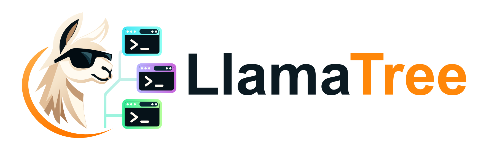
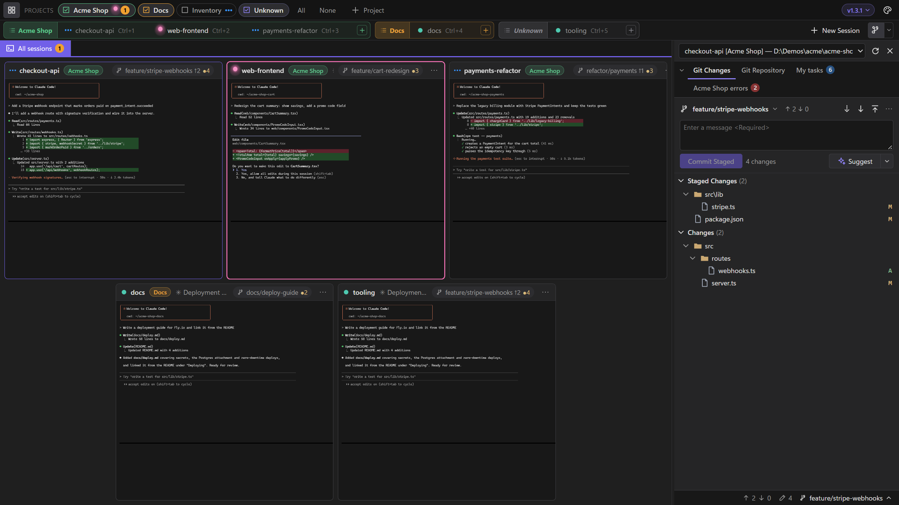
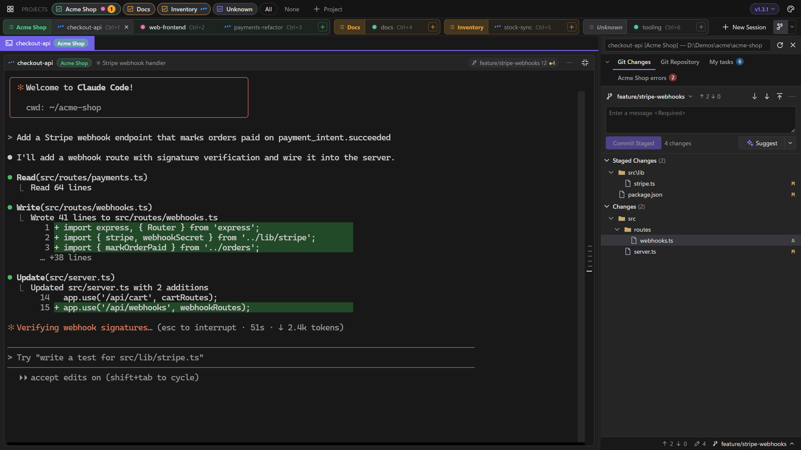
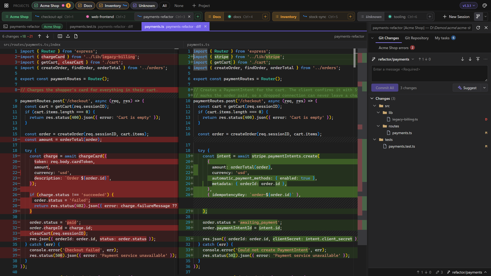
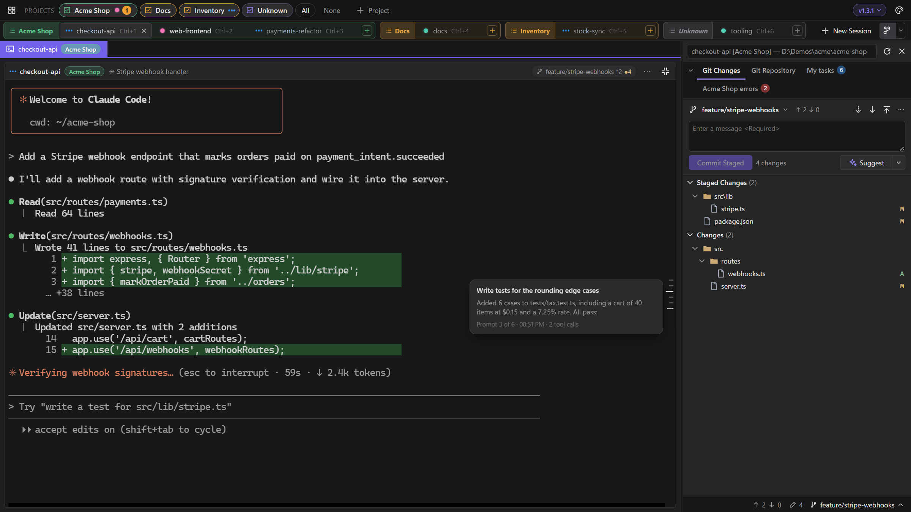
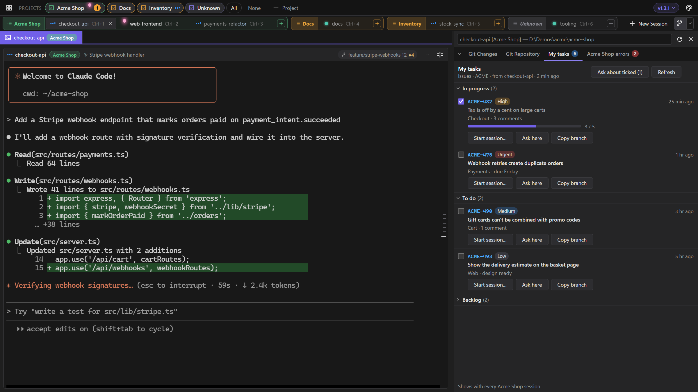

<h1>
  <picture>
    <source media="(prefers-color-scheme: dark)" srcset="docs/brand/LlamaTree-Logo.svg">
    
  </picture>
</h1>

**[llamatree.dev](https://llamatree.dev)** · *Formerly Claude Terminals.*

One window for many Claude Code and Codex sessions, on this computer and on your servers, with a Visual Studio–style Git Changes / Git Repository view and diff viewer for each session's worktree.

**[Read the guide on llamatree.dev](https://llamatree.dev/docs/)** · [Install](#install) · [Guide in this repository](docs/README.md)



<table>
  <tr>
    <td width="50%"><a href="docs/images/session.png"></a><br><sub>Click a tile to work in that session full-size; <code>Shift+Esc</code> goes back.</sub></td>
    <td width="50%"><a href="docs/images/diff.png"></a><br><sub>VS-style side-by-side diffs open in tabs next to the terminal.</sub></td>
  </tr>
  <tr>
    <td width="50%"><a href="docs/images/rail.png"></a><br><sub>The ticks beside the terminal are your prompts: hover for a preview, click to read that part of the conversation.</sub></td>
    <td width="50%"><a href="docs/images/panels.png"></a><br><sub>Panels Claude shows beside the terminal, with ticks, badges and buttons that fill in a prompt for you.</sub></td>
  </tr>
</table>

<sub>Screenshots show a fictional demo project with simulated sessions; regenerate them with <code>tools\screenshots\run.ps1</code>.</sub>

## What it does

- **All your sessions in one window.** Every Claude Code or Codex session runs in its own real terminal, shown side by side as live tiles. Status dots show which are working, which are waiting for you and which need an answer. Group them into [projects](docs/sessions.md), and keep them running when the window closes.
- **Sessions on your servers, among your own.** Run a session on a Linux server over SSH and work with it beside your local ones: typing, Git, files and panels all work as they do locally, and it keeps running there when the connection drops. [Sessions on a server](docs/servers.md)
- **Git, Visual Studio style.** Each session's worktree gets Git Changes (stage, commit, Undo Changes, fetch, pull, push), Git Repository (history, outgoing commits), a branch picker and side-by-side diffs that update as the agent edits. **Suggest** writes the commit message. [Git](docs/git.md)
- **Agents that work together.** Sessions can message each other, and an agent can start sessions of its own, drive them and close them, with you deciding what each may do. [Panels and messages](docs/panels.md) · [Helper sessions](docs/helpers.md)
- **Panels from Claude.** Claude can show your task list, an error summary or notes as a tab beside the Git panel, through an MCP server built into the app. [Panels](docs/panels.md)
- **Claude Code and Codex, side by side.** Each session keeps a conversation of its own and picks it up again when the app restarts. [Claude Code and Codex](docs/claude-and-codex.md)
- **Your colours, your plugins.** Light or dark in your accent colour, and plugins that add tabs of their own. [Customize](docs/customize.md)
- **Keeps itself up to date.** Tells you when a new version is out and installs it in a click; your sessions carry on afterwards.

## Install

**Windows** (PowerShell):

```powershell
powershell -c "irm https://github.com/LlamachantTechnology/LlamaTree/releases/latest/download/install.ps1 | iex"
```

**Linux:**

```sh
curl -fsSL https://github.com/LlamachantTechnology/LlamaTree/releases/latest/download/install.sh | sh
```

Each downloads the latest release, checks it against the checksums we sign for every release with our code signing certificate (and, on Windows, the installer's own signature), and installs it. Both scripts are in [tools/install](tools/install) if you'd like to read them first. You can also download the Windows setup, or the `.deb`, `.rpm` or `.tar.gz`, from the [latest release](https://github.com/LlamachantTechnology/LlamaTree/releases/latest).

You need [Claude Code](https://docs.anthropic.com/en/docs/claude-code) and/or the [Codex CLI](https://github.com/openai/codex), plus Git. LlamaTree runs on Windows 10 1809+ and Windows 11 (x64) and on 64-bit Linux; on macOS it runs built from source for now. See [Getting started](docs/getting-started.md) for the details.

## Documentation

The guide is on **[llamatree.dev/docs](https://llamatree.dev/docs/)**, and the same pages are in [docs/](docs/README.md) here. Changes to LlamaTree update them in the same pull request.

## Building

```powershell
cd web; npm ci; cd ..                                   # once: xterm.js + Monaco
dotnet run --project src\LlamaTree -f net10.0-windows   # the Windows app
dotnet test                                             # tests
```

See [Building LlamaTree](docs/building.md) for macOS and Linux, how it's put together, the installer and releasing.

Contributions are welcome: see [CONTRIBUTING.md](CONTRIBUTING.md) for how to report a bug, where to start and what a pull request needs.

## License

Apache License 2.0, see [LICENSE](LICENSE) and [NOTICE](NOTICE). Copyright 2026 Llamachant Technology Ltd. Versions up to 1.2.0 were released under the MIT License, which still applies to them. The license doesn't grant use of the LlamaTree or Llamachant names or logos (section 6). Bundles [xterm.js](https://github.com/xtermjs/xterm.js) and [Monaco Editor](https://github.com/microsoft/monaco-editor) (both MIT).
