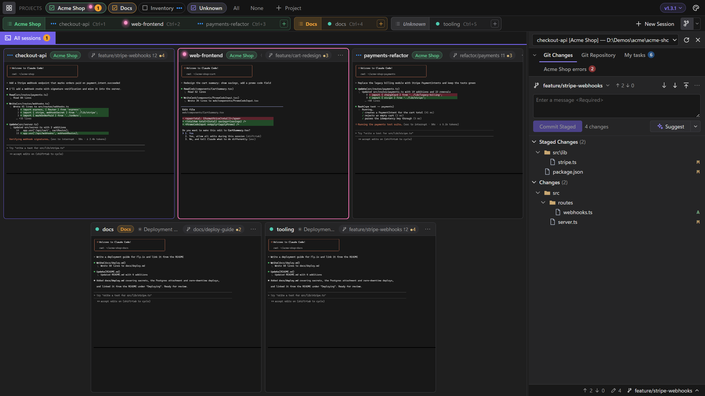

# Getting started

LlamaTree is a desktop app that runs your Claude Code and Codex sessions side by side, shows which one needs you, and gives each one a Git panel. This page gets you from nothing to three sessions in a few minutes.

## What you need

- **Windows 10 (1809 or later) or Windows 11**, x64; or a **64-bit Linux desktop** (x86-64, Intel or AMD).
- [Claude Code](https://docs.anthropic.com/en/docs/claude-code) and/or the [Codex CLI](https://github.com/openai/codex), installed and signed in, on your `PATH`. Check by running `claude` or `codex` in a terminal.
- **Git.**
- On Windows, the **WebView2 runtime**, which setup takes care of (see [Windows](#windows)).

LlamaTree uses your own Claude Code and Codex, with your own plans. There's no LlamaTree account.

To build LlamaTree yourself you also need the .NET 10 SDK and Node.js; see [Building](building.md).

## Install

### Windows

Run this in PowerShell:

```powershell
powershell -c "irm https://github.com/LlamachantTechnology/LlamaTree/releases/latest/download/install.ps1 | iex"
```

It downloads the latest installer, checks it against the SHA-256 GitHub publishes for it, and installs it silently for your account. No administrator rights are needed. The script is in [tools/install](https://github.com/LlamachantTechnology/LlamaTree/tree/main/tools/install) if you'd like to read it first.

Or download `LlamaTree-Setup-<version>.exe` from the [latest release](https://github.com/LlamachantTechnology/LlamaTree/releases/latest) and run it. It also installs for your account only, and later versions install themselves from inside the app (see [Updates](#updates)).

Releases are signed by **Llamachant Technology Ltd**. If SmartScreen still warns about a new release ("Windows protected your PC"), check that the publisher is Llamachant Technology Ltd, then choose *More info › Run anyway*.

LlamaTree needs the WebView2 runtime. It's built into Windows 11, and setup offers to download it on Windows 10 if it's missing.

### Linux

```sh
curl -fsSL https://github.com/LlamachantTechnology/LlamaTree/releases/latest/download/install.sh | sh
```

It downloads the latest release and checks it against the SHA-256 GitHub publishes for it. When there's apt, dnf or zypper and you can use sudo, it installs the `.deb` or `.rpm` (it asks for your password), so WebKitGTK and libnotify come with it. Otherwise it unpacks the `.tar.gz` into `~/.local/share/LlamaTree`, with a `llamatree` command in `~/.local/bin` and a menu entry, for your account only. To choose that anyway, set `LLAMATREE_INSTALL=tar`:

```sh
curl -fsSL https://github.com/LlamachantTechnology/LlamaTree/releases/latest/download/install.sh | LLAMATREE_INSTALL=tar sh
```

The script is in [tools/install](https://github.com/LlamachantTechnology/LlamaTree/tree/main/tools/install) if you'd like to read it first.

To install by hand, download the package for your distribution from the [latest release](https://github.com/LlamachantTechnology/LlamaTree/releases/latest). The package manager installs what it needs with it; nothing else is needed (no .NET, no Node.js).

| Distribution | Package | Install |
|---|---|---|
| Ubuntu, Debian, Mint, Pop!_OS… | `llamatree_<version>_amd64.deb` | Open it in your software centre, or `sudo apt install ./llamatree_<version>_amd64.deb` |
| Fedora, openSUSE, RHEL… | `llamatree-<version>-1.x86_64.rpm` | `sudo dnf install ./llamatree-<version>-1.x86_64.rpm` (openSUSE: `sudo zypper install …`) |
| Anything else | `LlamaTree-<version>-linux-x64.tar.gz` | Install WebKitGTK 4.1 and libnotify, unpack it anywhere and run `LlamaTree` |

Then start **LlamaTree** from your applications menu, or run `llamatree`. It's 64-bit Intel/AMD (x86-64) only for now.

To uninstall, see [Uninstalling](troubleshooting.md#uninstalling).

### macOS

LlamaTree runs on macOS, but there's no signed app bundle yet, so for now you run it from source. You need the [.NET 10 SDK](https://dotnet.microsoft.com/download) and Node.js.

```sh
git clone https://github.com/LlamachantTechnology/LlamaTree && cd LlamaTree
(cd web && npm ci) && dotnet run --project src/LlamaTree
```

On a Mac, <kbd>⌘</kbd> does what <kbd>Ctrl</kbd> does on Windows. A copy built from source doesn't update itself: *Check for updates* tells you when a new version is out and links its release.

## Your first sessions

1. Press <kbd>Ctrl</kbd>+<kbd>Shift</kbd>+<kbd>N</kbd>, or click **New Session**.
2. Pick where it runs (*Computer*: this one, or a [server](servers.md)) and the folder of a project. The command is `claude` by default; change it to `codex` for Codex, or to anything else (a shell, a dev server).
3. Choose **New conversation**, or resume one of your saved conversations.
4. Optionally, put the session in a **project** so it's grouped with related sessions.

Add two or three more. To give each task its own branch, use the **+** at the end of a project's tabs › *In a new worktree…*: LlamaTree creates the worktree on a new branch and starts a session in it.

> [!TIP]
> Try one session per worktree. Each agent works on its own branch, the Git panel shows exactly what each one changed, and the Project view lines them all up.

## Finding your way around



- **Projects row** (top): tick projects on and off. Hidden sessions keep running.
- **Session tabs**: one per session, grouped by project. Click one, or press <kbd>Ctrl</kbd>+<kbd>1</kbd>…<kbd>9</kbd>, to open it full size. Click it again, or press <kbd>Shift</kbd>+<kbd>Esc</kbd>, to go back to the tiles.
- **Tiles**: every visible session, live. The dot by each name is its status: blue while working, **pink when it needs your answer**, orange when it finished while you weren't watching, green when idle.
- **Side panel** (right): Git Changes and Git Repository for the selected session, plus any panels its agent shows you. <kbd>Ctrl</kbd>+<kbd>Shift</kbd>+<kbd>G</kbd> toggles it.
- **Palette button** (top right): theme, accent colour, status dot style, plugins and permissions.
- **Version chip** (top right): check for updates, tips and offers, and what closing the window does. When an update is out, an **Update** button appears in the title bar.

Plain <kbd>Esc</kbd> always goes to the terminal, because Claude Code uses it to interrupt.

## Updates

A few seconds after starting, and every 15 minutes, LlamaTree checks the latest GitHub release (an anonymous request; nothing about you or your sessions is sent). When there's a newer version, an **Update to x.y.z** button appears in the title bar, showing what's new.

*Update and restart* downloads the new version, checks it against the checksum signed for the release with our code signing certificate and, on Windows, checks that the installer itself is signed by Llamachant Technology Ltd (it won't run a file that fails either), closes the app, installs it and reopens it. Running sessions carry on in the conversations they were in.

- **Windows:** the installer runs silently.
- **Linux, from a package:** the `.deb` or `.rpm` you installed from is downloaded and checked the same way, then installed with apt, dnf or zypper behind your desktop's administrator password prompt. A cancelled prompt leaves things as they were.
- **Linux, from a `.tar.gz`:** a copy unpacked into a folder you own is replaced by the new one.
- **macOS** (for now): the button links the release instead.

The version is shown at the top right and in the window title. Click it for *Check for updates*, and untick *Check for updates automatically* to turn the automatic check off. *Count me among the users*, in the same menu, is the answer you gave to *May we count you?* (see [Counting users](privacy.md#counting-users)).

## Next

- [Sessions and projects](sessions.md): status dots, conversations and the Project view.
- [Git and diffs](git.md): reviewing and committing what your agents changed.
- [Panels and messages](panels.md): letting agents show you things and talk to each other.
- [Helper sessions](helpers.md): agents that hand work to agents of their own.
- [Sessions on a server](servers.md): agents on another machine, over SSH, beside your local ones.
- [Keyboard shortcuts](shortcuts.md).
