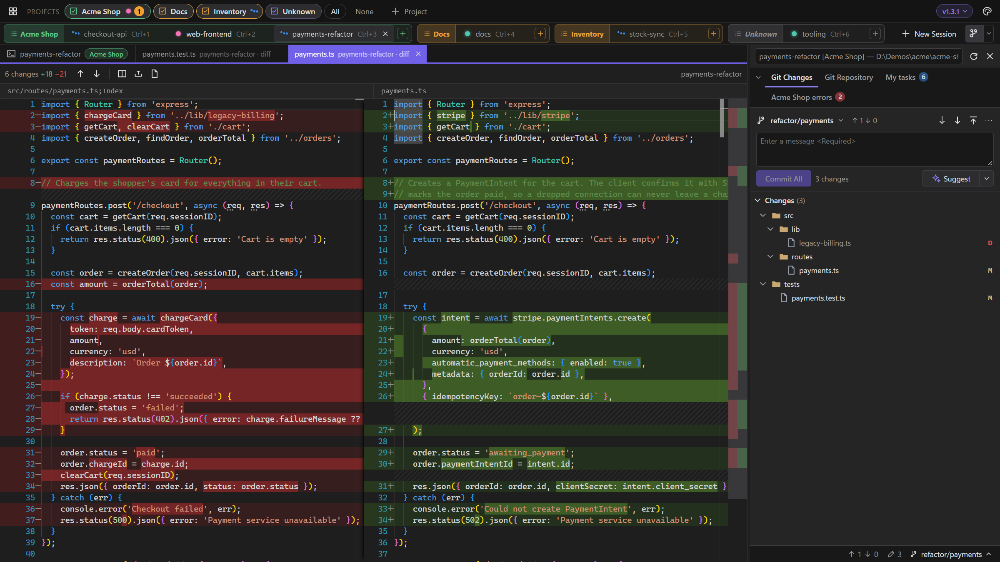
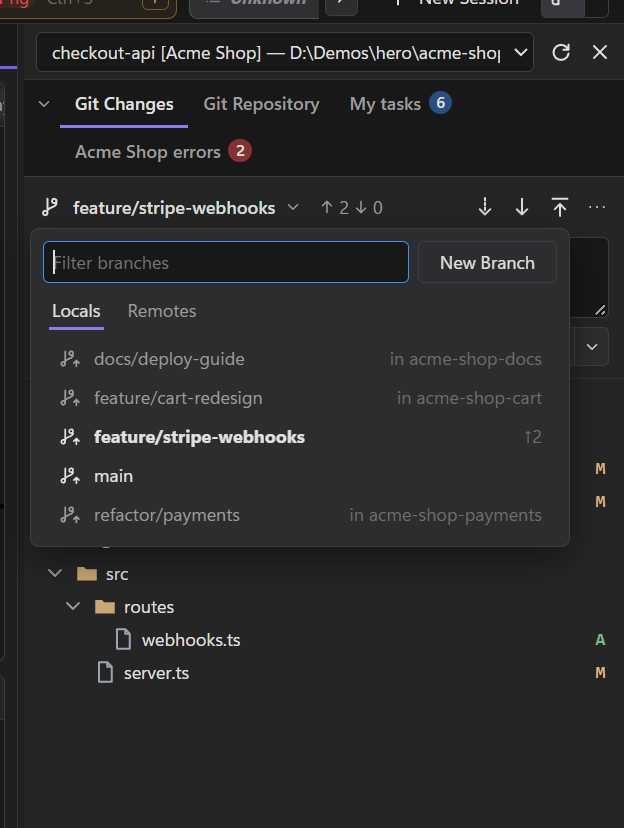
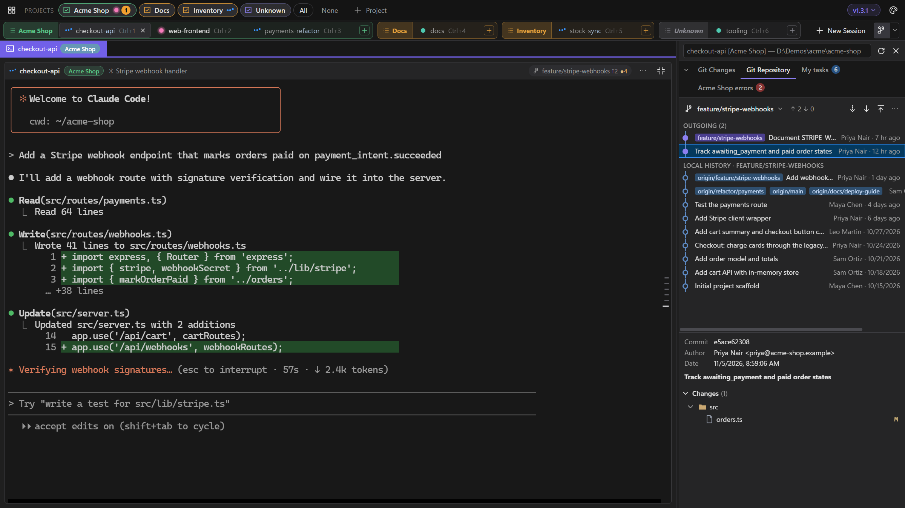

# Git and diffs

The side panel shows the selected session's repository, laid out like Visual Studio: Git Changes for what's in the working tree, Git Repository for history. Diffs open in tabs beside the terminal and refresh as the agent edits.

## Git Changes

- **Staged and unstaged trees,** with stage and unstage on each file or folder.
- **Commit** what's staged, or everything when nothing is.
- **Undo Changes**, as in Visual Studio (right-click a file or folder, or the ↶ on a section header): new files go to the Recycle Bin (the Trash on macOS and Linux). It refuses rather than guesses if the files changed after you confirmed, or if restoring would overwrite a file that now exists at a deleted or renamed file's old name.
- Right-click a folder for **Open in File Explorer** (your file manager on macOS and Linux).

## Diffs

Click any file, in Git Changes or in a commit in Git Repository, for a side-by-side diff (Monaco, with Visual Studio-style colours). A single click opens a reusable preview tab (in italics); double-click keeps it open. Open diffs refresh as the session edits the file. <kbd>Alt</kbd>+<kbd>↑</kbd>/<kbd>↓</kbd> jumps between changes.

- **Tabs belong to their session's project:** switching to a session in another project shows that project's tabs, and yours come back when you return.
- **Closing:** <kbd>Ctrl</kbd>+<kbd>W</kbd> or <kbd>Ctrl</kbd>+<kbd>F4</kbd>, middle-click, or the tab's ×. In the terminal, <kbd>Ctrl</kbd>+<kbd>W</kbd> stays Claude's delete-word.
- **Back to the terminal:** click the Terminal tab, <kbd>Shift</kbd>+<kbd>Esc</kbd> from a diff, or <kbd>Ctrl</kbd>+<kbd>PgUp</kbd> / <kbd>Ctrl</kbd>+<kbd>PgDn</kbd>.

Drag a diff tab towards an edge of the terminal area to show it beside the terminal, so you can watch the agent's output and its changes at once. See [Sessions](sessions.md) for more on putting a tab beside the terminal.

## Suggest

**Suggest**, beside Commit, writes the commit message for what Commit would take (the staged changes, or all of them), in the style of the repository's recent commits. <kbd>Ctrl</kbd>+<kbd>Z</kbd> brings back what was in the box. The ▾ beside it sets how much it writes, remembered for next time:

- *Short*: one line;
- *Standard*: a line, plus a few brief points when a change covers several things;
- *Detailed*: a line and a paragraph on what changed and why.

It runs the session's own agent headless with your own sign-in, sending it the diff, so it uses a little of that agent's plan: Claude Code as `claude -p` (Haiku, no tools, not saved as a conversation), Codex as `codex exec` (read-only, low reasoning, not saved). A session running anything else uses Claude Code.

## Fetch, pull and push

They sit on the Git panel's toolbar, next to the branch and its outgoing and incoming counts.

- **Pull only fast-forwards.** It never creates a merge commit or leaves conflicts in a worktree an agent may be editing, and stops with git's explanation if the branch has diverged.
- **Push never forces.** A branch with no upstream is published to `origin` and tracked.
- Each runs for up to five minutes, long enough to sign in through Git Credential Manager.

## Branches

Click the branch name on the Git toolbar, or in Git Changes' status bar, for the **branch picker**: filter as you type, with *Locals* and *Remotes* tabs. Picking a remote branch switches to its local branch, creating one that tracks it if needed.

- **New Branch** (in the picker, the ⋯ menu, or a commit's right-click menu in Git Repository) takes a name and what to base it on, a branch or a commit, and can switch to it.
- **Switching with uncommitted changes** asks first: bring the changes with you, or stash them and continue. If the switch fails, the stash is put back.
- **The status bar** under Git Changes shows the outgoing and incoming counts (click for Git Repository), the number of changed files and the branch.

## Git Repository

Outgoing commits and history, with each commit's files. Click a file for that commit's diff.

## Pull requests

When the branch has an open pull request on GitHub or Azure DevOps, a **PR 958 ▾** chip appears beside it, with *Open in Browser*, *Refresh*, *View Pull Requests* and *New Pull Request*.

To find it, LlamaTree calls that service's API with the credential Git Credential Manager already holds for the remote. The credential is only sent to that service, over HTTPS. The lookup never opens a sign-in window: without a stored credential there's simply no chip. Results are cached for 3 minutes.

## Not using Git?

The ▾ beside the side panel button in the title bar turns **Git Changes** and **Git Repository** on or off, each on its own (or right-click either tab › *Hide Git Changes* / *Hide Git Repository*). With both off, the side panel holds only your agents' [panels](panels.md) and side-panel [plugins](customize.md#plugins), and stays out of the way until one opens. The button stays, so the ▾ can always bring them back.

- The branch chip on each tile still shows the branch and its changes.
- A tab you turn back on returns where it was.
- The same ▾ lists what's open in the side panel, reopens a closed panel and resets the layout.
