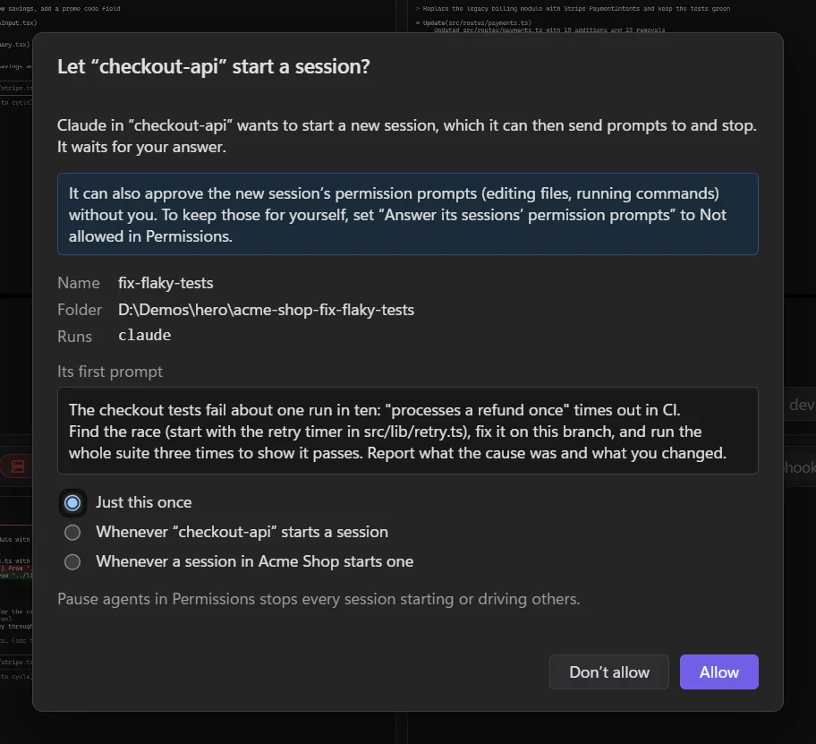

# Helper sessions

An agent can start sessions of its own: another agent like itself, working in parallel on a separate piece of the job. It hands over the task, waits for the result, and closes the helper when it's done, while you watch every helper in its own tile.

## What it looks like

Ask a session something like "split out the flaky test fix into its own branch and keep going on the webhook". The agent starts a helper named *fix-flaky-tests*, on a new branch in a worktree of its own, with the whole task as its first prompt. The helper appears as a tile in the same project, with its own Git panel. The first agent carries on, checks back when it's ready, reads what the helper did, and closes it.

## What an agent can do

Through LlamaTree's built-in MCP server, the same one that shows [panels and messages](panels.md), an agent gets these tools for the sessions it started:

| Tool | Does |
|---|---|
| `start_session` | Starts a helper (same agent and options) with a name and a first prompt, in this session's folder, a folder of the same project, or on a new branch in a new worktree. |
| `send_prompt` | Types and sends another prompt, once the helper is idle. |
| `get_session` | How it's doing: working, idle, waiting on a permission prompt, or stopped, with its last prompt and reply. |
| `wait_for_session` | Waits until it stops working, up to 110 seconds at a time. |
| `answer_prompt` | Approves (this once) or declines a permission prompt the helper is waiting on. |
| `interrupt_session` | Presses Esc in it. |
| `stop_session` | Ends its agent, leaving the session for you to look at. |
| `close_session` | Stops it and removes it from LlamaTree. Its conversation is kept to resume, and a worktree made for it stays. |

Agents only ever drive sessions they started themselves, never yours.

## You decide

The first time an agent wants to start a session, LlamaTree shows you its name, folder, command and first prompt. Allow it **just this once**, **whenever that session starts one**, or **whenever a session in the project starts one**. A helper that wants to start helpers of its own is always asked about on its own rule.

Permissions › **Agents** sets three abilities for every session, project or all sessions:

| Ability | With no rule |
|---|---|
| Start sessions | You're asked each time |
| Answer its sessions' permission prompts | Allowed |
| Close its sessions | Allowed |

**Pause agents** in Permissions stops every session starting or driving others at once.

## Limits and safety

- **Held to its folder.** A helper starts only in a folder it was allowed (this session's, one the project uses, or a worktree made for it), checked with links resolved, and held as its process starts, so it can't be moved elsewhere on the way.
- **Five at a time** from one session, ten in all.
- **Nothing is hidden:** each helper has a tile and tab like any other session, so you can watch it or step in at any point, and each close is logged.
- **On servers too:** a session on a [server](servers.md) can start helpers there, under the same rules.
