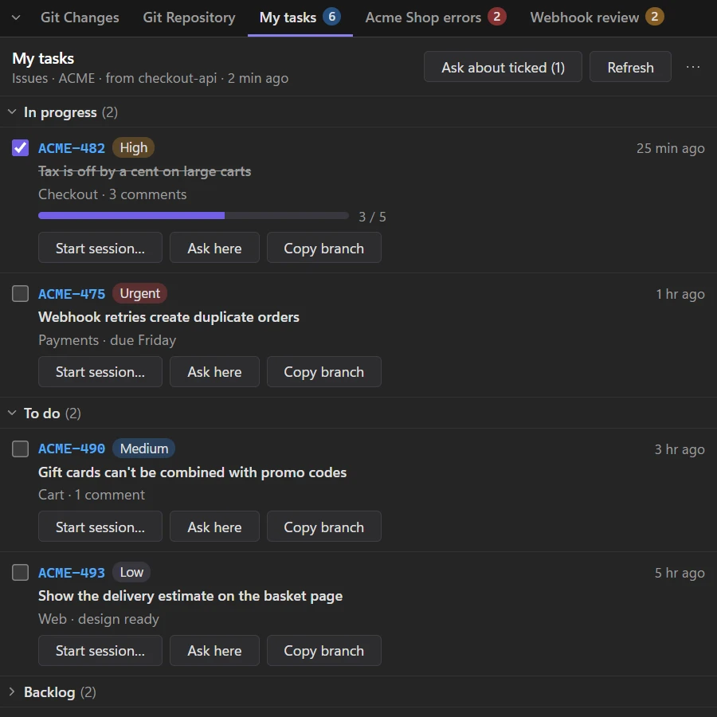
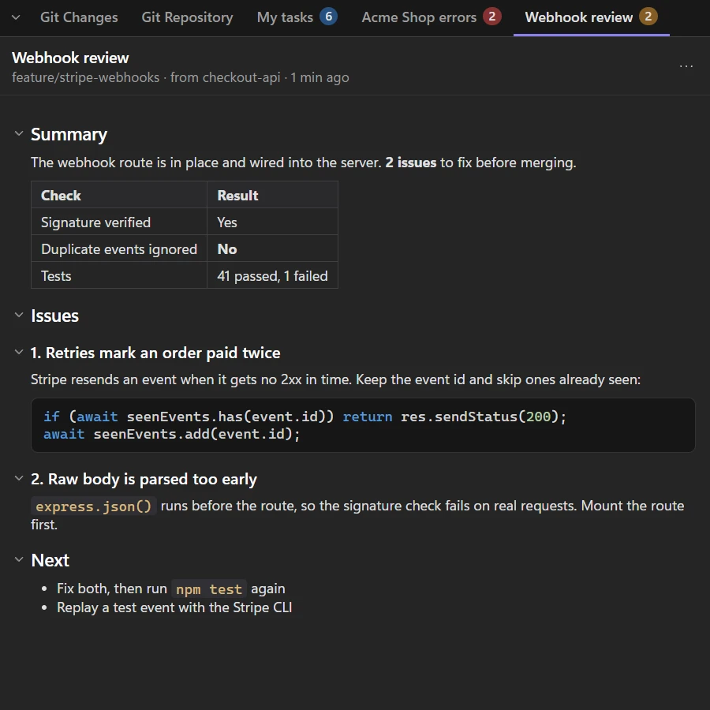
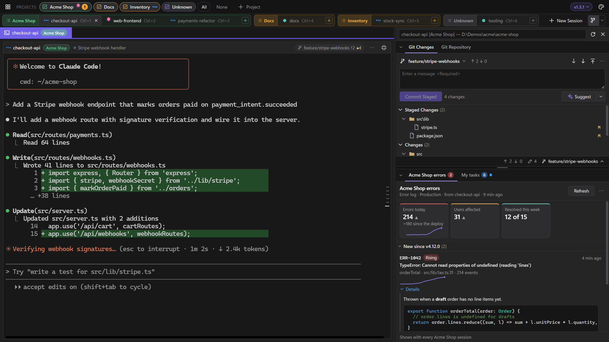
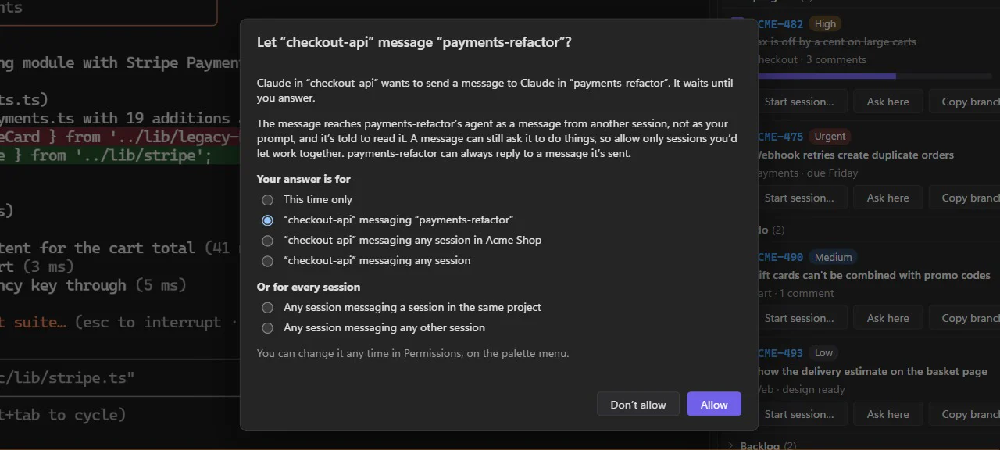

# Panels and messages

LlamaTree starts each Claude and Codex session with a small MCP server built into the app. Through it, agents can show you panels beside the terminal and send messages to each other.

## Panels

A panel is a tab next to Git Changes and Git Repository that an agent fills: your task list, an error summary, a checklist. It holds Markdown, or a list of items (a key, title, badges, a link and buttons), optionally in groups up to three levels deep. Groups and Markdown headings fold with a click, and the app remembers what you folded in each panel. When there are more tabs than fit, ◀ ▶ arrows scroll them, as in the other tab rows.

LlamaTree has no code for any tracker or service. Agents fill panels with whatever they can reach through your own MCP servers and skills, so a team can share a `/my-tasks` skill that reads their tracker and shows the result in a panel.

### How agents reach the app

Each session is started pointing at the `llamatree` MCP server inside the app, on `127.0.0.1` at a port picked when the app starts: Claude Code with `--mcp-config`, Codex with the server's settings on its command line. Its panel tools (`show_panel`, `update_panel`, `close_panel`, `list_panels`, `get_panel`) are allowed without asking. Every session has its own token, which ties each panel to the session that made it and keeps other programs out. Your own MCP servers still load as usual; a command that passes its own `--mcp-config` is left alone.

### What a panel can hold

- a count on its tab;
- figure tiles at the top, with trend arrows and small trend lines;
- items with times that stay current ("4 min ago"), progress bars, badges and trend lines;
- **Details** that open under an item, in Markdown, with code coloured by language;
- tick boxes. Your ticks are saved, the agent can read them (`get_panel`), and they survive a refresh.

Long lists get a filter box. Everything is drawn by the app from plain data: agents never supply HTML, SVG or scripts.

### Buttons never run anything

- *Here* buttons type their prompt into the session you're looking at, for you to send.
- *New* buttons open **New session** with the folder, project and first prompt filled in; that session starts a new conversation with the prompt you leave there.
- **Refresh** sends the panel's refresh prompt (for example `/my-tasks`) to the session that made it.
- Buttons can also copy a text (a branch name, a command) to the clipboard.

### Working with a panel

- **Updated dot:** a tab the agent has updated since you last looked at it gets a dot.
- **Ask about ticked (n):** types the ticked items into the session you're looking at, so you can say what to do with them.
- **Sorting:** the ⋯ menu sorts list items by time, key or title, remembered per panel.
- **Copy as Markdown** copies a panel's content.

### Getting started

Right-click any side panel tab › *Example panel skill…* shows a ready-made `/my-tasks` skill (groups by status, ticks, Start session / Ask here / Copy branch buttons, Refresh). Save it as `.claude/skills/my-tasks/SKILL.md` and point it at your tracker's MCP tools.

### Arranging the side panel

- **Moving tabs:** drag a tab (Git Changes, Git Repository or a panel) onto another group's tab row to move it there, or onto the top or bottom half of a group to split it into a new group above or below. Right-click a tab for the same moves, *Reset layout* and *Reopen a closed panel*.
- **Sizing:** drag the dividers to resize. The chevron at the left of a tab row (or double-clicking the row) folds a group down to its tabs. The layout is remembered.
- **Where a panel shows:** with the session that made it, by default. Its ⋯ menu shows it with every session of that project, or with every session, instead. The tabs follow the selected session.
- **Panels stay** until you close them (middle-click the tab, or ⋯ › *Close panel*; both ask first) or remove their session, including across restarts. A panel closed by mistake can be brought back while the app runs: right-click any tab › *Reopen a closed panel*. Panels are kept in `panels.json` next to `sessions.json`.

## Messages between sessions

Claude and Codex sessions can message each other, through the same `llamatree` MCP server that shows panels, so neither needs a connection of its own. Ask an agent to "ask the api session what it changed in the parser", and it sends the question to that session and waits for the answer.

The tools agents get are:

- **`list_sessions`**: the other sessions this one may message;
- **`send_message`**: `to` (a session's name or id), `text`, and `reply_to` when it answers a message;
- **`wait_for_reply`**: waits for the answer to a message it sent, up to 110 seconds (50 by default, since Codex cuts a tool call off at 60);
- **`read_messages`**: this session's unread messages, each read once.

Agents can also start and drive sessions of their own: see [Helper sessions](helpers.md).

### You decide who may message whom

The first time a session messages one it has no rule for, LlamaTree asks you. Your answer can be for **this time only** (delivered or dropped, and you're asked again next time), or a rule: for that pair of sessions, for that session messaging any session in its project, or any session at all, or for every session (the **All sessions** rules). Closing the dialog leaves the message waiting. Rules go one way, and a session can always reply to a message it was sent, for an hour.

### How messages arrive

- **The sender is the session that called the tool**, known from its own token, never a name it claims.
- A message reaches the other agent through `read_messages` or `wait_for_reply`, marked as from another agent rather than from you, so it's weighed as a colleague's request, not your prompt.
- **Telling a session it has messages:** once it's idle (not working or asking you something) and you haven't typed into it for a few seconds, LlamaTree types and sends one line saying who it has messages from and to read them with `read_messages`. If that line stays unsent in Claude's prompt (Claude was redrawing, or still starting), LlamaTree presses Enter again, a few times at most, and never once you've typed into that session.
- **A session waiting to be opened is started by its message**, so the sender isn't left waiting until you open it. It's told about the message once its agent is up. A stopped session is told when it next runs.

### Exchanges end

A message and the replies to it can run to 12 messages, so two agents allowed to answer each other can't go on forever. Past that a reply is refused, and the agent is told to tell you where things stand and start afresh only if you ask.

### Limits

Up to 8,000 characters a message, 20 messages a minute from a session, 20 waiting for your answer per pair, and 100 unread per session. The rules are kept in `relay.json` next to `sessions.json`, and unread and waiting messages and the log in `relay-messages.json`, so they outlast a restart.

### Seeing and changing it

- **On a tile:** a session with unread messages shows an envelope and their count (click to see them), and one that may message others by rules of its own shows a link. Its **⋯** menu has **Permissions…**.
- **Permissions**, in the palette menu, counts the messages waiting for your answer. Its **By session** view shows each session's rules (see [Permissions](customize.md#permissions)), with **Pause messages** to stop all of it at once.
- **Permissions › Messages** lists the latest 500 messages, newest first, from every session or one: who sent what to whom, when, and whether it's unread, read, waiting for your answer (click to answer), refused or dropped. Open one to read all of it; **Clear** forgets those done with.
