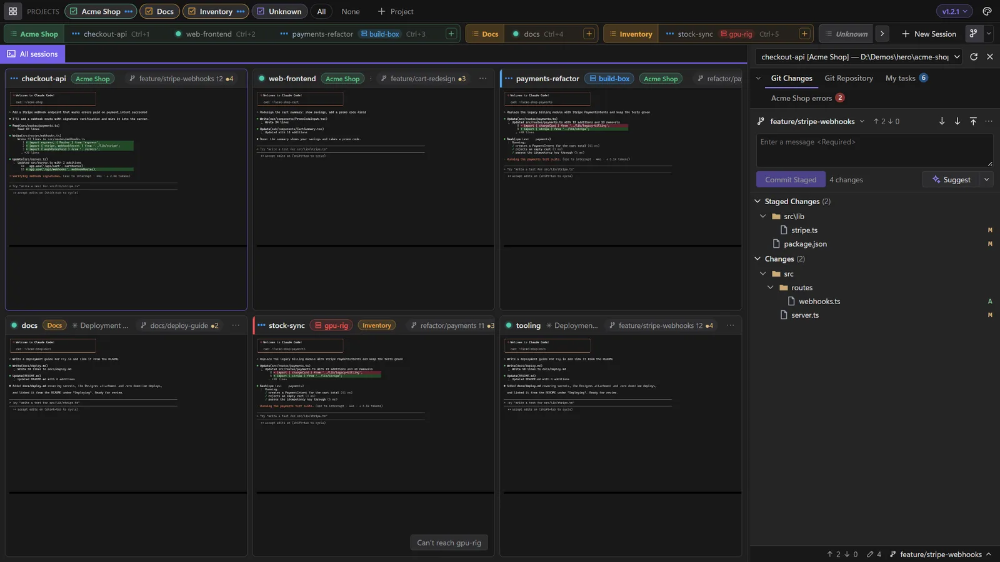
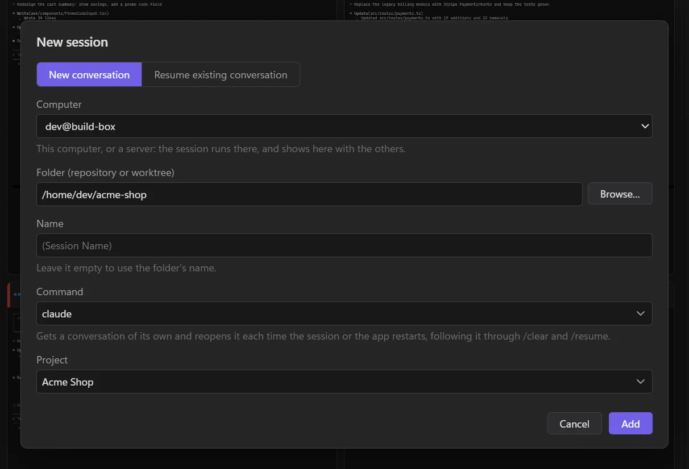

# Sessions on a server

Run agents on another machine (a build box, a cloud VM, a beefy desktop) and work with them right beside your local sessions. They run on the server, in its folders, and keep running when LlamaTree closes or the connection drops.

## What you need

- **`ssh` on this computer.** Windows 10 and 11 have it built in, as do macOS and Linux.
- **Key or ssh-agent sign-in.** LlamaTree can't type a password. Connect once from a terminal first (`ssh user@server`) so the server's host key is known.
- **Claude Code or Codex on the server**, installed and signed in, since that's where they run.
- **LlamaTree on the server.** It gives the `llamatree` command that LlamaTree runs there. If it isn't there yet, LlamaTree says so and offers *Install LlamaTree on `<server>`…* (see [below](#installing-llamatree-on-the-server)). The server doesn't need a desktop.

These are the same for sessions among your own and for a [server in a window of its own](#a-server-in-a-window-of-its-own).



*payments-refactor runs on build-box; gpu-rig is offline, so its session says it can't be reached.*

## Adding a session on a server

In **New Session**, *Computer* picks where the session runs: this computer, or a server, entered as any of:

- `user@server`
- `ssh://user@server:port`
- a `Host` from your SSH config, with its user, port, key and jump hosts



The server's sessions show with your local ones, in your projects, with the server's name on their tile and a link mark on their tab. Typing, Git, diffs, *Browse…*, opening files and pasting pictures all work as for a local session, on that server. Once LlamaTree has connected to a server, every session that server's LlamaTree has shows here too.

While the server is connected, its sessions' panels show here, and they can message your local sessions and be messaged by them, with the same [permissions](panels.md#you-decide-who-may-message-whom).

## Installing LlamaTree on the server

When a server doesn't have LlamaTree, its sessions' badge and menu say so, as does adding a session there, each with *Install LlamaTree on `<server>`…*. Once you say yes, the server runs the install script from the latest release over SSH: the package, with sudo, when that needs no password; otherwise a copy for your account that updates itself. Then LlamaTree connects again.

If the server's sudo wants a password, LlamaTree shows you the command to run there yourself. It checks the package's SHA-256 before installing. Or install it by hand, as on any Linux machine:

```sh
curl -fsSL https://github.com/LlamachantTechnology/LlamaTree/releases/latest/download/install.sh | sh
```

A server with the `.deb` or `.rpm` package is updated there as you update its other packages.

## It keeps running

The sessions belong to a LlamaTree session host on the server, not to your window. Close LlamaTree, put your laptop to sleep or lose Wi-Fi, and they carry on. Meanwhile the tile says *Can't reach* the server and LlamaTree keeps trying; click the server's name to try again now.

> [!WARNING]
> If the server ends your processes when you log out (systemd's `KillUserProcesses`), run `loginctl enable-linger` there once, or the sessions end with the connection.

## The server's files

- **Browsing:** *Browse…* in New Session, and *Browse the folder* wherever you'd open one in File Explorer or Finder, show the server's folders in the window.
- **Opening a file** (a path link in the terminal, Git's *Open*, a file in those folders) copies it to this computer and opens it here, as it would be locally. It's a copy, so edits to it stay here.
- **Pasting** a screenshot or files into a session copies them to the server first, then pastes their paths there. They're kept in LlamaTree's data folder on the server, under `pasted/`, and cleared after a week.
- **Plugins** installed on the server show as they would locally: the window is sent a copy of each plugin's folder. Web links open on this computer.

## A server in a window of its own

To keep a server's sessions apart from yours, start LlamaTree with `--remote`:

```powershell
LlamaTree --remote user@server
```

That opens a window for just that server's sessions. They run on the server, in its folders, and keep running there when the window closes or the connection drops; the window reconnects by itself when the connection comes back. The server can also be `ssh://user@server:port` or a `Host` from your SSH config.

## How it works

LlamaTree runs `ssh -T -o BatchMode=yes <server> llamatree --attach` and talks to the server's session host over that connection, the same way your window talks to your own. Nothing listens on a network port, so there's nothing to open in a firewall. When SSH drops, only that connection ends; the sessions don't.

A server can't take over this computer: files it sends are accepted only when you asked to open something, its plugins get ids of their own, and there are limits on how much it can send. To use a different ssh program, set `LLAMATREE_SSH`; to run something other than `llamatree --attach` on the server, set `LLAMATREE_REMOTE_COMMAND`.
