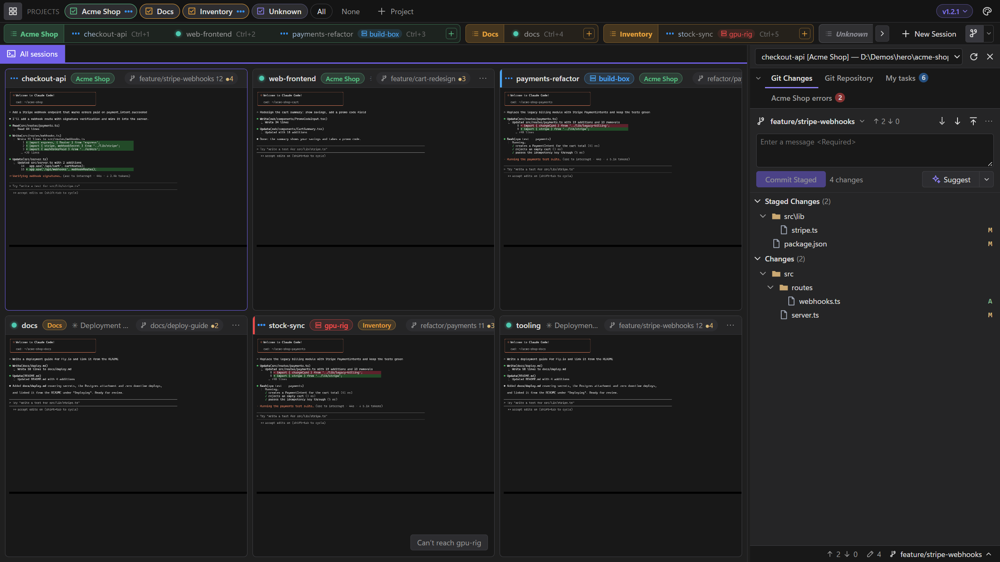
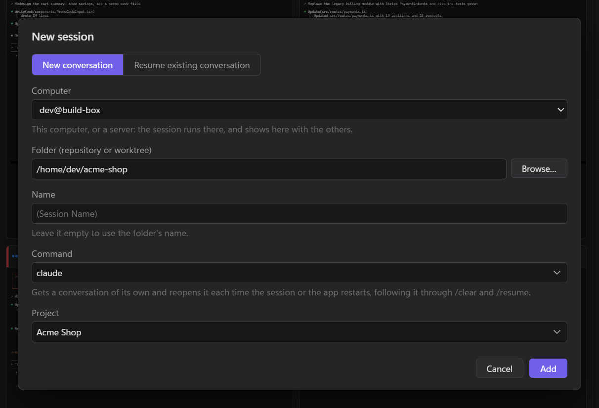

# Sessions on a server

Run agents on another machine (a build box, a cloud VM, a beefy desktop) and work with them right beside your local sessions. They run on the server, in its folders, and keep running when LlamaTree closes or the connection drops.

## What you need

- **`ssh` on this computer.** Windows 10 and 11 have it built in, as do macOS and Linux.
- **A Linux server** (x86-64) that you can reach with SSH. LlamaTree can't be installed on a Mac or Windows server yet.
- **Key or ssh-agent sign-in.** LlamaTree can't type a password. Connect once from a terminal first (`ssh user@server`) so the server's host key is known. If you haven't set up a key, see [Setting up SSH](#setting-up-ssh).
- **Claude Code or Codex on the server**, installed and signed in, since that's where they run.
- **LlamaTree on the server.** It gives the `llamatree` command that LlamaTree runs there. If it isn't there yet, LlamaTree says so and offers *Install LlamaTree on `<server>`…* (see [below](#installing-llamatree-on-the-server)). The server doesn't need a desktop.

These are the same for sessions among your own and for a [server in a window of its own](#a-server-in-a-window-of-its-own).



*payments-refactor runs on build-box; gpu-rig is offline, so its session says it can't be reached.*

## Setting up SSH

Skip this if `ssh user@server` already signs you in without asking for anything. Otherwise, these steps take a few minutes, once per computer. Run them on the computer LlamaTree runs on, not on the server.

### 1. Make a key

```sh
ssh-keygen -t ed25519
```

Press Enter to keep the usual file (`.ssh/id_ed25519` in your home folder). It asks for a passphrase: give it one and let ssh-agent remember it (step 3), or leave it empty, which is simpler but means anyone with a copy of the file can use it.

### 2. Put the key on the server

On macOS and Linux:

```sh
ssh-copy-id user@server
```

Windows has no `ssh-copy-id`; in PowerShell, run:

```powershell
type $env:USERPROFILE\.ssh\id_ed25519.pub | ssh user@server "mkdir -p ~/.ssh && chmod 700 ~/.ssh && cat >> ~/.ssh/authorized_keys && chmod 600 ~/.ssh/authorized_keys"
```

Each asks for your password on the server one last time. Then `ssh user@server` should sign in without it.

### 3. Let ssh-agent hold the passphrase

Only for a key with a passphrase. LlamaTree can't type it, so ssh-agent has to hold the unlocked key.

- **Windows:** the OpenSSH agent is installed but turned off. In PowerShell run as administrator, once:

  ```powershell
  Get-Service ssh-agent | Set-Service -StartupType Automatic
  Start-Service ssh-agent
  ```

  Then, in an ordinary PowerShell, `ssh-add` and type the passphrase. Windows keeps the key in the agent from then on, after restarts too.
- **macOS:** `ssh-add --apple-use-keychain ~/.ssh/id_ed25519`, and add `UseKeychain yes` and `AddKeysToAgent yes` under `Host *` in `~/.ssh/config`, so the passphrase comes from your keychain after a restart.
- **Linux:** most desktops start an agent for you; run `ssh-add` once per sign-in.

### 4. Give the server a short name (optional)

An entry in your SSH config (`.ssh/config` in your home folder; create it if there isn't one) lets you type `build-box` in LlamaTree in place of the whole address, and holds anything else the server needs:

```
Host build-box
    HostName 203.0.113.10
    User dev
    Port 22
    IdentityFile ~/.ssh/id_ed25519
```

Only `HostName` is needed; leave out the lines you don't. For a server you reach through another, add `ProxyJump user@gateway`.

### Different kinds of server

- **A Linux machine on your network:** it needs an SSH server. On Ubuntu or Debian, `sudo apt install openssh-server`; on Fedora, `sudo dnf install openssh-server`, then `sudo systemctl enable --now sshd`. Use its name or IP address as the server.
- **A cloud VM** (Azure, AWS, Google Cloud and the like): sign in with the user and key the provider set up when you made it. The user is often fixed by the image: `ubuntu` on Ubuntu, `ec2-user` on Amazon Linux, `azureuser` if you kept Azure's suggestion. Point `IdentityFile` at the key file you downloaded, and check that the VM's firewall or security group lets in SSH (port 22). LlamaTree needs no other port.
- **A server behind a gateway or VPN:** connect the VPN first, or reach it through the gateway with `ProxyJump` as above.

## Adding a session on a server

In **New Session**, *Computer* picks where the session runs: this computer, or a server, entered as any of:

- `user@server`
- `ssh://user@server:port`
- a `Host` from your SSH config, with its user, port, key and jump hosts



The server's sessions show with your local ones, in your projects, with the server's name on their tile and a link mark on their tab. Typing, Git, diffs, *Browse…*, opening files and pasting pictures all work as for a local session, on that server. Once LlamaTree has connected to a server, every session that server's LlamaTree has shows here too.

While the server is connected, its sessions' panels show here, and they can message your local sessions and be messaged by them, with the same [permissions](panels.md#you-decide-who-may-message-whom).

## Installing LlamaTree on the server

When a server doesn't have LlamaTree, its sessions' badge and menu say so, as does adding a session there, each with *Install LlamaTree on `<server>`…*. Once you say yes, the server runs the install script from the latest release over SSH: the package, with sudo, when that needs no password; otherwise a copy for your account that updates itself. Then LlamaTree connects again.

If the server's sudo wants a password, LlamaTree shows you the command to run there yourself. It checks the package's SHA-256, from the release's signed list of checksums, before installing. Or install it by hand, as on any Linux machine:

```sh
curl -fsSL https://github.com/LlamachantTechnology/LlamaTree/releases/latest/download/install.sh | sh
```

A server with the `.deb` or `.rpm` package is updated there as you update its other packages.

## It keeps running

The sessions belong to a LlamaTree session host on the server, not to your window. Close LlamaTree, put your laptop to sleep or lose Wi-Fi, and they carry on. Meanwhile the tile says *Can't reach* the server and LlamaTree keeps trying; click the server's name to try again now.

> [!WARNING]
> If the server ends your processes when you log out (systemd's `KillUserProcesses`), run `loginctl enable-linger` there once, or the sessions end with the connection.

## The server's files

- **Browsing:** *Browse…* in New Session, and *Browse the folder* wherever you'd open one in File Explorer or Finder, show the server's folders in the window.
- **Opening a file** (a path link in the terminal, Git's *Open*, a file in those folders) copies it to this computer and opens it here, as it would be locally. It's a copy, so edits to it stay here.
- **Pasting** a screenshot or files into a session copies them to the server first, then pastes their paths there. They're kept in LlamaTree's data folder on the server, under `pasted/`, and cleared after a week.
- **Plugins** installed on the server show as they would locally: the window is sent a copy of each plugin's folder. Web links open on this computer.

## A server in a window of its own

To keep a server's sessions apart from yours, start LlamaTree with `--remote`:

```powershell
LlamaTree --remote user@server
```

That opens a window for just that server's sessions. They run on the server, in its folders, and keep running there when the window closes or the connection drops; the window reconnects by itself when the connection comes back. The server can also be `ssh://user@server:port` or a `Host` from your SSH config.

## A Windows PC as the server

If you work across several Windows PCs, any of them can be the server: a desktop's sessions, from your laptop. Windows has an SSH server built in, *OpenSSH Server*, which is all it needs.

> [!IMPORTANT]
> The server PC's account must be a **local account, a Microsoft account, or an on-premises domain account**. Windows' SSH server can't sign in a Microsoft Entra ID (work or school, "AzureAD\…") account with a key, and LlamaTree only signs in with one.

On the PC that will be the server:

1. **Turn on OpenSSH Server.** In PowerShell, as administrator:

   ```powershell
   Add-WindowsCapability -Online -Name OpenSSH.Server~~~~0.0.1.0
   Set-Service sshd -StartupType Automatic
   Start-Service sshd
   ```

   Or in *Settings → System → Optional features → Add a feature*, then start the *OpenSSH SSH Server* service. Either way, Windows opens port 22 in its firewall for it.
2. **Add your other computer's public key** (the contents of its `~/.ssh/id_ed25519.pub`):
   - **If your account on the server is an administrator** (usually it is, on your own PC), the key goes in `C:\ProgramData\ssh\administrators_authorized_keys`, not in your own `.ssh` folder. Windows ignores that file unless only Administrators and SYSTEM can use it, so, in PowerShell as administrator:

     ```powershell
     Add-Content -Path C:\ProgramData\ssh\administrators_authorized_keys -Value '<your public key>'
     icacls C:\ProgramData\ssh\administrators_authorized_keys /inheritance:r /grant "*S-1-5-32-544:F" /grant "*S-1-5-18:F"
     ```

   - **Otherwise**, it goes in `C:\Users\<you>\.ssh\authorized_keys`, as on Linux.
3. **Install LlamaTree** there as usual, or let LlamaTree on your other computer install it when you first add a session there (it runs the release's `install.ps1`: setup for your account, no admin).

Then add a session with *Computer* set to `you@that-pc`. Connect once from a terminal first (`ssh you@that-pc`) so the PC's host key is known.

- **Stay signed in on the server.** Its sessions run in your desktop session there, as they would if you'd opened LlamaTree on it, so Git's sign-ins (Credential Manager) and everything else work as usual, and LlamaTree on that PC shows the same sessions. A locked screen is fine. If you aren't signed in, LlamaTree still starts them, but under your SSH sign-in, which can't use Credential Manager, and (for an administrator) LlamaTree opened on that PC can't show them until they've ended.
- **Commands run in cmd**, the OpenSSH Server's default. If you've made PowerShell its default shell (`DefaultShell`), LlamaTree can't connect.
- **Updating:** update LlamaTree on that PC itself (*Check for updates* in its menu). Updating it from your other computer is for Linux servers.
- **Other networks:** to reach a PC that isn't on your network, put both computers on [Tailscale](https://tailscale.com) or another VPN, and use the address it gives. Don't forward port 22 on your router.

## How it works

LlamaTree runs `ssh -T -o BatchMode=yes <server> llamatree --attach` and talks to the server's session host over that connection, the same way your window talks to your own. (On a Windows server, whose shell has no `sh`, it runs `LlamaTree.exe --attach` from where setup put it.) Nothing listens on a network port of LlamaTree's own, so there's nothing to open in a firewall beyond SSH's. When SSH drops, only that connection ends; the sessions don't.

A server can't take over this computer: files it sends are accepted only when you asked to open something, its plugins get ids of their own, and there are limits on how much it can send. To use a different ssh program, set `LLAMATREE_SSH`; to run something other than `llamatree --attach` on the server, set `LLAMATREE_REMOTE_COMMAND`.
