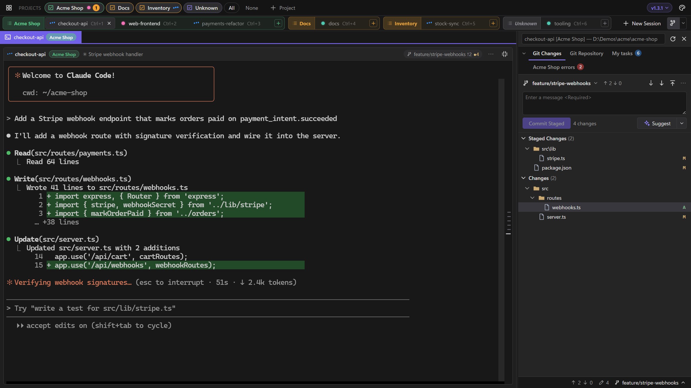
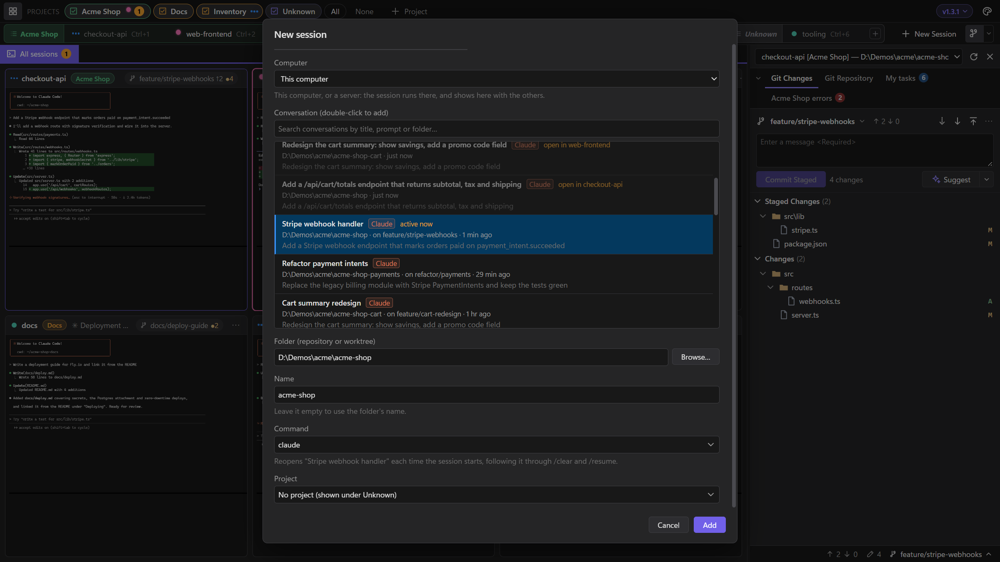
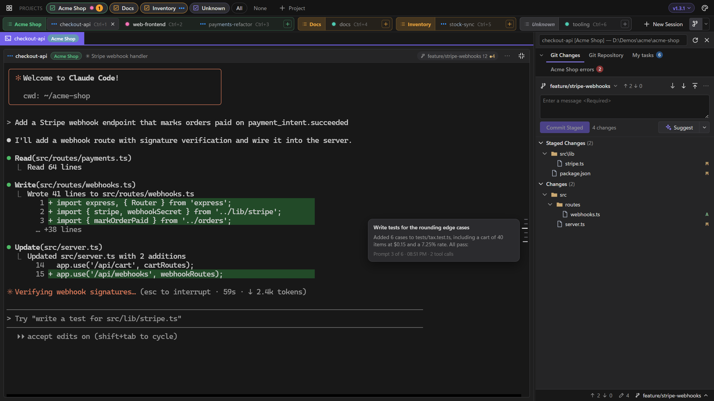
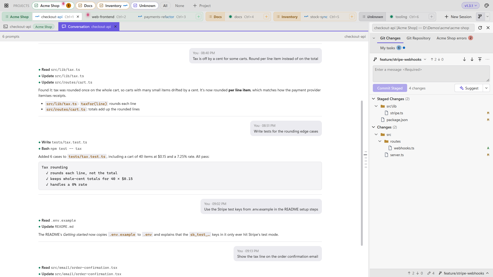
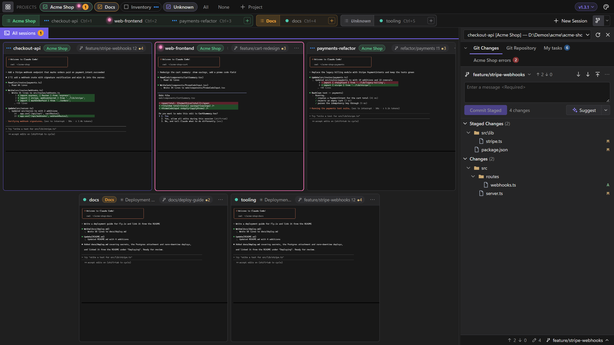

# Sessions and projects

A session is one agent (or any command) running in its own real terminal, in a folder you choose. Projects group sessions, and the Project view lines up every worktree of a repository.

## Working with sessions

Click a session's tile, or its tab in the title bar, to work in it full-size; click its tab again, or press <kbd>Shift</kbd>+<kbd>Esc</kbd>, to go back to all sessions. **New session** (<kbd>Ctrl</kbd>+<kbd>Shift</kbd>+<kbd>N</kbd>) starts a new conversation, optionally one session per worktree, or resumes an existing one. [Keyboard shortcuts](shortcuts.md) lists the rest.

- **Close a session** with the × on its tab, or middle-click the tab. After you confirm, the session is removed and its process stopped. The folder isn't touched.
- **Reorder tabs** by dragging session, project or diff tabs, or right-click › *Move left/right*. Unknown stays last.

## Status dots

Every session's tab and tile carries a dot. Each state has its own colour, shape and motion, so you can tell them apart at a glance:

| State | Means |
|---|---|
| **Working** (blue) | The agent is busy. Its name shimmers on the tab too. |
| **Needs your answer** (pink) | The agent is asking for a permission, a question, a plan to approve or whether to trust the folder, and can't carry on until you answer. It goes back to normal once you have. |
| **Waiting for you** (orange) | The session finished working while you weren't watching it (or rang the bell). |
| **Idle** (green) | Done, and you've seen it. The dot has a slowly breathing glow, and when a session finishes while you watch it, the dot pops in with one ring. |
| **Not running** (grey ring) | The process has stopped. The hollow ring stays still. |

How working, waiting and asking move is up to you: the palette button › **Status dots** shows four styles side by side, each moving, and previews the one you click on the whole app.

| Style | Working | Waiting for you | Needs your answer |
|---|---|---|---|
| **Glow** (default) | three dots bounce in turn | the dot beats and glows | the dot hops, landing with a small ring, and glows as it leaps |
| **Classic** | a comet spins round a breathing core | a dot in a ring, sending out a ping | the dot hops, and the session's tab lights up with a pink outline |
| **Calm** | a ring with a gap turns slowly | a dot in a ring, fading gently | a pink diamond that slowly swells |
| **Signal** | a ring fills round a small core | a square light blinking | a dot in a ring that shakes |

A theme can come with status dots of its own (see [Themes and plugins](customize.md#status-dots-of-its-own)). While it's on, they're one more card, first in **Status dots**, and they're used until you pick another style. That choice holds for that theme only: your own style comes back with every other theme, and picking the theme's card again brings its dots back.

With your OS's animation effects turned off, the dots stay still, and in every style their shapes still tell the states apart.

## Each session has its own conversation

A new Claude session's command is just `claude` (plus any options you add). LlamaTree gives it a conversation id of its own and starts it with `--session-id <id>`, then with `--resume <id>` once something is saved, so restarting the app or the session always reopens the same conversation, even with several sessions in one folder.

- When you `/clear` or `/resume` inside Claude, LlamaTree follows it to the new conversation once Claude has saved it.
- Hover a session's tab, or the name on its tile, for its conversation's title, when it started and when it was last used (or that it's a new one, with nothing in it yet). *Edit session* shows the id.
- Commands with their own `--resume`, `--session-id` or `--fork-session` are left alone.
- **Older sessions:** a session made with `claude --continue` (the previous default) starts on the folder's latest conversation once, then keeps that one. A plain `claude` session saved before 1.1.0 never told the app which conversation it was in, so it gets a new one of its own, and the app says once which sessions those are; *Resume a different conversation…* takes one back to an earlier conversation.

Codex sessions work the same way, with a few differences: see [Claude Code and Codex](claude-and-codex.md#codex).

### Resuming a conversation

In **New session**, or a session's ⋯ menu › *Resume a different conversation…*, pick any saved conversation from the list. That makes it the session's conversation; *New conversation* gives the session a fresh one instead. The list reads Claude Code's saved conversations from `~/.claude/projects`, and Codex conversations, tagged *Codex*. Conversations used in the last few minutes are tagged *active now*: close them in any other terminal first.

### Closing the window

Closing the window with sessions running asks what to do with them:

- **Keep running** closes only the window. The sessions carry on in the background, and opening LlamaTree again shows them as they are, with what they printed meanwhile.
- **Stop sessions** stops them, but loses nothing: each conversation is kept, and the sessions come back with the app. The question says which pick up where they left off (those that continue or resume) and which start a new conversation.

Tick *Don't ask again* to always do one or the other; the version menu (top right) changes it, and has *Quit and stop all sessions*. With no session running, closing the window ends LlamaTree.

### Restarting

After a restart, the sessions come back, each in its own conversation. A Claude or Codex session brought back after a restart waits until you first click on its terminal (its tile says *Starts when you click it*; pressing Enter in it works too). Its start-up context, such as hooks, the date and Git status, is then fresh when you use the session, and a session you don't click on costs nothing. A message from another session starts it too, so the sender isn't left waiting. New sessions, and sessions running other commands (a dev server, say), start straight away.

To have a Claude or Codex session start as soon as LlamaTree opens instead, set **Starts** when you add it in *New session*, or later in its ⋯ menu › *Rename / edit command…*:

- **When you first click on its terminal**: the default, as above.
- **When LlamaTree opens, if its terminal was running when LlamaTree last closed**: brings back the sessions you were using, whether you stopped them by closing LlamaTree, signing out or restarting the computer. A session you stopped yourself, or whose Claude you quit (`/exit`), waits to be clicked on as usual.
- **When LlamaTree opens, always**.

## Conversation rail and tab

The ticks down the right edge of the open terminal are the prompts you've sent in that session, newest at the bottom. Hovering one shows the prompt and the start of the agent's reply.

Clicking a tick (or right-click › *Show conversation*) opens the session's **Conversation** tab next to the diff tabs, scrolled to that prompt. It shows the whole conversation as text: your prompts, the answers with their formatting, and the tool calls (long runs folded). It follows along while the agent works, and its own rail jumps between prompts.

Both come from the agent's saved transcript (a Claude session's process names it in `~/.claude/sessions`), so they work in Claude's full-screen mode, which keeps no terminal scrollback. Nothing is sent anywhere.

## Projects

Projects group sessions, for example one product across its worktrees. Tick projects on and off in the Projects row; **All** and **None** do what they say, and <kbd>Ctrl</kbd>+click (or right-click › *Show only this project*) shows only one. Sessions with no project are grouped under **Unknown**, which you tick and untick like a project. Each session's tab and tile carry a tag in its project's colour, so two sessions with the same name in different projects can be told apart. Hidden sessions keep running, and each project's tab counts its sessions waiting for you, so a hidden project still gets noticed.

**Projects as tabs.** With many projects, the row of filters gets busy. Right-click the Projects row's free space › *Projects as tabs* to show each project as a tab instead: a click shows only that project's sessions, clicking it again (or **All**) goes back to every project, and <kbd>Ctrl</kbd>+click adds or removes a project alongside the ones shown. Every project starts pinned to the row. Hover a tab and click its pin (or right-click › *Unpin*) to move it into the **▾** list after the tabs. Picking a project there shows it as a tab in italics, with its pin ready to put it back on the row. The ▾ shows a dot and a count when a session in an unpinned project is waiting for you. This is an option of the *Projects and sessions across the top* layout; the other layouts list projects down the left.

- **Put a session in a project** when you add it, by dragging its tab into the project's group, or right-click its tab › *Move to project…*
- **Rename, recolour, reorder or delete** a project by right-clicking it. *Edit project* sets its name and colour (a swatch, a custom colour or Automatic). Deleting a project keeps its sessions; they just have no project.
- **Add a session to a project** with the **+** at the end of its tab group (at the end of the row when there are no projects). It works from that project's current session, or its first:
  - *In the same folder* adds a session there in one click, with a conversation of its own.
  - *In a new worktree…* (only in a Git repository) creates a worktree on a new branch, next to the repository by default, and opens a session there, unless you untick *Start a session in it*.
  - *A different folder…* opens New session with the project chosen.

## Project view

Click a project's name at the start of its tab group to see every worktree of its repositories in one table. It's also on a session's ⋯ menu, a session tab's right-click menu, and a project's right-click menu in the Projects row. It opens the way a session's tab does: no session is open, and the tab row holds just its Project tab. Click the project's name again, or a session's tab, to leave it.

The rows come from git's own worktree list, one per worktree of each repository the project's sessions are in, so worktrees made outside LlamaTree, or whose session was closed, show too. With no projects, it covers every session. Each row shows:

- the branch and folder, and the session in it (or *no session*) with its status dot;
- what the session is on: its status and latest prompt, or its conversation's title while it isn't running;
- how many files are changed, with a ⚠ when the same file is also changed in another worktree of the same repository (a line under the table names the file and both worktrees, and lights their rows when hovered);
- how far the branch is ahead of (↑) and behind (↓) the base branch (what `origin/HEAD` points at, else a local `main` or `master`);
- its open pull request, as the Git panel's chip finds it.

The summary line counts the worktrees, how many need you, how many are behind the base branch and how many can be removed.

Click a row for the latest prompt and the start of the answer, the changed files, what's worth knowing (behind the base branch, merged, not in a pull request yet) and the actions:

- **Open session** (or **Conversation**), and **Start a session here** for a worktree that has none, with the options of the project's other sessions;
- **View PR** or **New pull request** in the browser;
- **Remove worktree…** for a worktree other than the main one. Its sessions are removed first, then git removes the folder. Removing never forces: a worktree with uncommitted changes is refused and left as it is, and the branch stays.

**New worktree…** on the toolbar adds a worktree of the project's repository on a new branch, started from its base branch (`origin/main`, say), with a session in it unless you untick *Start a session in it*. A project with sessions in several repositories asks which. The new branch has no upstream until its first Push, which publishes it under its own name.

The view follows the sessions as they work and re-reads the repositories every half minute (or on **Refresh**).

## Where sessions are kept

Sessions are saved in `%APPDATA%\LlamaTree\sessions.json` on Windows and `~/.config/LlamaTree` on Linux. Set `LLAMATREE_DATA` to use a different folder, for separate profiles or testing. Only one copy of LlamaTree runs per profile; launching it again brings the window forward.

> [!NOTE]
> Until 1.2 the app was called Claude Terminals. The first time 1.2 runs, it moves `%APPDATA%\ClaudeTerminals` and `%LOCALAPPDATA%\ClaudeTerminals` to their new names, and the old `CLAUDE_TERMINALS_DATA` still works.
